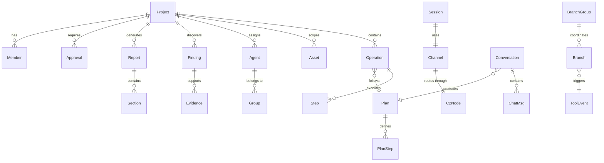
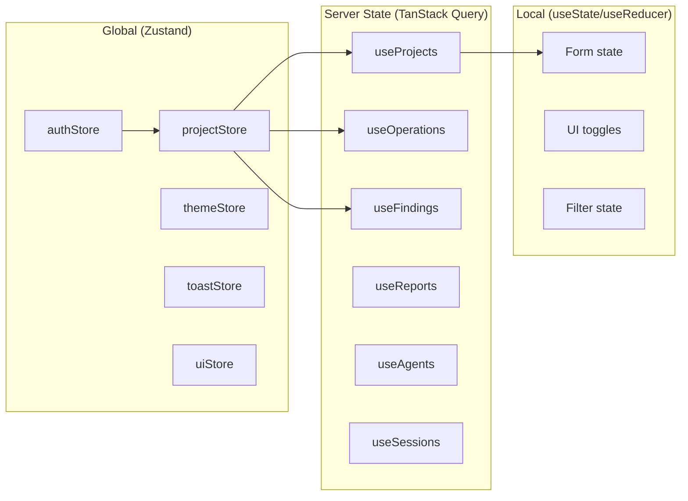

# Raptix Web — Implementation Plan

> **Platform:** Red Team Management & AI-Assisted Offensive Security Operations
> **Stack:** React 19 · TypeScript 5.7 · Vite 8 · Tailwind CSS v4 · Lucide Icons
> **Status:** Analysis & Architecture Design (Pre-Implementation)

> **Execution authority (2026-10-13):** Use the corrected
> [spec](.scratch/web-improve-refactor/spec.md),
> [execution contract](.scratch/web-improve-refactor/execution.md) and
> [coverage/ticket mapping](.scratch/web-improve-refactor/coverage.md) for implementation.
> The original weekly tables below are a roadmap, not executable ticket boundaries.
> Git/worktree preparation is still required. Baseline tests characterize existing
> behavior at its actual store/helper/UI site; missing deadline and approval enforcement
> is implemented by the owning tickets, not assumed green in the export.

---

## 1. Current State Analysis

### 1.1 Project Overview

The existing codebase is a Figma Make export of a **Red Team Management Platform** — a comprehensive system for managing penetration testing engagements, AI-assisted offensive operations, C2 infrastructure, and compliance reporting. The UI is functionally rich but architecturally unsuitable for production.

### 1.2 Codebase Inventory

| File | Size | Purpose |
|------|------|---------|
| `store.tsx` | 97 KB (1,225 lines) | Monolithic React Context store — state, actions, business logic, RBAC |
| `data.ts` | 70 KB (468 lines) | Type definitions + `seed()` function generating all mock data |
| `shell.tsx` | 67 KB (873 lines) | App shell — sidebar, header, project switcher, modals, copilot drawer |
| `ui.tsx` | 43 KB (631 lines) | Shared component library — ~40 reusable primitives |
| `index.css` | 3 KB | Tailwind v4 theme with light/dark mode CSS custom properties |
| `App.tsx` | 1 KB | Router + StoreProvider entry point |
| **35 screen files** | **~1.2 MB total** | All pages, sub-views and demo surfaces |

### 1.3 Domain Model (Entities)

The system manages **20+ domain entities** with rich relationships:



### 1.4 Route Map (Current)

The current routing uses hash-based navigation (`#/page/id?tab=tab`) with **53 registered route keys** across 9 groups. The table below is a partial feature index; capture the complete source registry before migration:

| Group | Route Key | Page/Feature | Source File |
|-------|-----------|--------------|-------------|
| **A — Core** | `login` | Persona selector login | `a-login.tsx` |
| | `command-center` | Red Team Command Center (no `dashboard` route alias) | `a-dashboard.tsx` |
| | `tasks` | My Tasks inbox | `a-dashboard.tsx` |
| | `forbidden`, `notfound`, `error`, `offline`, `session-expired` | System/error states | `a-system.tsx` |
| | `states` | Component showcase gallery | `a-system.tsx` |
| **B — Projects** | `projects` | Project portfolio list | `b.tsx` |
| | `project-new` | 5-step project wizard | `b-wizard.tsx` |
| | `project` | Detail with 13 tabs (overview, scope, plans, operations, sessions, findings, reports, team, close…) | `b-detail.tsx` + `b-detail2.tsx` |
| **C — Operations** | `operations` | Operations list with status filters | `c.tsx` |
| | `operation-new` | Operation creation form | `c.tsx` |
| | `preflight` | 8-point preflight verification | `c.tsx` |
| | `operation` | Live execution workspace (6 tabs) | `c-console.tsx` |
| **D — Infrastructure** | `agents` | Fleet management (project + pool) | `d-agents.tsx` |
| | `agent` | Agent health & capabilities | `d-agents.tsx` |
| | `assets` | Asset catalog with bulk import | `d-assets.tsx` |
| | `asset` | Asset detail (ports, findings, ROE) | `d-assets.tsx` |
| | `asset-new` | Asset creation | `d-assets.tsx` |
| | `playbooks` | ATT&CK tradecraft catalog | `d-library.tsx` |
| | `playbook` | Playbook detail (steps, techniques) | `d-library.tsx` |
| **E — Intelligence** | `analysis` | ATT&CK matrix + attack path graph | `e-analysis.tsx` |
| | `findings` | Findings inventory with severity donuts | `e-findings.tsx` |
| | `finding` | 6-stage finding lifecycle detail | `e-findings.tsx` |
| | `finding-new` | Finding creation + AI suggestion import | `e-findings.tsx` |
| | `evidence` | Evidence detail viewer | `e-findings.tsx` |
| **F — Reports** | `reports` | Report catalog + templates + delivery history | `f.tsx` |
| | `report-new` | Create report draft | `f-report.tsx` |
| | `report` | Section-based report editor | `f-report.tsx` |
| | `report-preview` | Formatted report preview; simulated checksums belong to export records | `f-report.tsx` |
| | `report-review` | Reviewer sign-off (four-eyes principle) | `f-report.tsx` |
| | `settings` | 10 enterprise admin tabs | `f-settings.tsx` |
| **G — AI Operator** | `ai-operator` | 3-pane AI workspace (chat + context) | `g-chat.tsx` |
| | `ai-plan` | Structured plan viewer | `g-plan.tsx` |
| | `ai-plan-review` | Plan approval with justification | `g-plan.tsx` |
| | `ai-plan-compare` | 3-way plan version diff | `g-plan.tsx` |
| | `ai-trace` | 4-facet tool execution audit | `g-trace.tsx` |
| | `ai-history` | AI provenance log | `g-trace.tsx` |
| | `ai-fanout` | Multi-agent branch overview | `g-fanout.tsx` |
| | `ai-branch` | Individual branch detail | `g-fanout.tsx` |
| **H — C2/Sessions** | `c2` | 5 tabs: infrastructure, channels, sessions, requests, audit | `h.tsx` |
| | `c2-channel` | Channel detail | `h.tsx` |
| | `c2-session` | Session detail + grant management | `h-session.tsx` |
| | `c2-console` | Interactive terminal with grant countdown | `h-session.tsx` |
| **Special** | `scenarios` | Demo scenario launcher (standalone) | `scenarios.tsx` |
| | `workspaces` | Workspace selector (standalone) | `scenarios.tsx` |

### 1.5 RBAC Model

6 roles with distinct permissions:

| Role | Key Capabilities |
|------|------------------|
| **Organization Admin** | Full access, settings management |
| **Red Team Manager** | Create/approve projects, manage team, approve plans |
| **Operator** | Execute operations, manage agents, create findings |
| **Reviewer** | Review/approve reports, findings, plans |
| **Analyst** | View operations, create findings, analysis |
| **Client / Viewer** | Read-only access to assigned projects |

Implemented via `can()` helper with 19 permission actions and project-scoped access control. Action-level enforcement is not uniform; see the corrected spec's baseline/target distinction.

### 1.6 Identified Issues

> [!CAUTION]
> **Critical architectural problems that MUST be resolved:**

1. **Monolithic store (97 KB)** — Single React Context holding ALL application state. Every state change triggers re-renders across the entire app. Contains ~70 action methods mixed with business logic.

2. **No feature module boundaries** — Screen modules depend directly on shared `store.tsx`, `data.ts`, and `ui.tsx`; entrypoint route imports are eager. No feature-based isolation or lazy loading boundaries.

3. **Hash-based routing without a router library** — Manual hash parsing and auth/page checks exist, including tab search params; navigation/guards need centralized router integration, lazy boundaries and consistent history/dirty behavior.

4. **Business logic mixed across store and screens** — Pure eligibility/preflight/closure helpers already exist in the store, while several approval/access checks and lifecycle rules remain in screens/hooks. Extract and test at their actual execution sites.

5. **No data fetching abstraction** — `seed()` returns the entire database as a single object. No API contracts, no request/response modeling, no caching strategy.

6. **No unified form management** — Forms use per-field state and inline validation, with custom dirty tracking. Consolidate schemas, dirty guards and submission/error behavior rather than assuming validation is absent.

7. **File naming** — Generic names like `a.tsx`, `b.tsx`, `c.tsx` provide zero semantic meaning.

8. **No code splitting** — All 1.2 MB of screen code loaded eagerly.

9. **No error boundaries** — A single component crash takes down the entire app.

10. **No testing infrastructure** — Zero tests, no test utilities, no mock factories.

### 1.7 Critical Safety Invariants (Must Preserve)

> [!IMPORTANT]
> These are **target requirements**. Existing enforcement is distributed across store, helpers and screens/hooks, with gaps documented in the execution contract. Preserve working behavior and add regression-tested enforcement for those gaps.

1. **Gated Execution** — Operations cannot start without 8/8 preflight checks passing (approved ROE, in-scope assets, online agents, approved plan, emergency contact, time window, playbook approved, no pending approvals).
2. **Emergency Stop State Machine** — `requested → acknowledged → stopped` (with failure path). Once stopped, operations never auto-resume; manual re-verification required.
3. **Four-Eyes Principle** — Authors cannot approve their own plans or reports. Reviews always require an independent reviewer persona.
4. **4-Facet Tool Evaluation** — Each tool event has 4 independent states: Proposed (by AI) → Policy (allowed/blocked by ROE) → Approval (by human reviewer) → Execution (by agent). Policy "Allowed" does NOT imply "Executed."
5. **AI Proposal Separation** — AI outputs are strictly proposals (`draft`/`proposed`). The AI never directly initiates tool execution from chat.
6. **Multi-Project Scope Isolation** — Switching projects completely purges cross-project data visibility. Session IDs, agent links, and findings from other engagements are never accessible.
7. **Time-Limited Session Grants** — Interactive C2 access requires explicit grants with countdown timers. Expired grants auto-revoke.
8. **Closure Checklist Enforcement** — Projects cannot close until: all operations ended, all live sessions terminated, all findings dispositioned, final report delivered, no outstanding approvals.
9. **Scope Re-validation** — Submitting an approved-scope revision immediately expires approved plans and resets ready operations to draft. Pending assets stay untargetable until approval; invalidation is not delayed until approval.
10. **Plan Approval Expiry (target)** — Approval expires 24 hours after the independent approval decision. The export records expiry metadata but does not fully enforce it; execute/start/resume must check the deadline in real domain/service logic.

Grant authorization must reject commands at the absolute deadline, even without a C2
page open. The 15-second sweep is cleanup, not an authorization grace period. The
preflight time-window placeholder also needs real domain evaluation; neither target
should be presented as already enforced by the baseline store.

### 1.8 Pure SVG Visualizations (Zero Dependencies)

The codebase includes custom zero-dependency SVG components that must be preserved or rebuilt:

| Component | Location | Purpose |
|-----------|----------|---------|
| `Donut` | `ui.tsx` | Donut chart with hover slices, percentage calc, legends |
| `BarChart` | `ui.tsx` | Responsive bar chart with gridlines, axis labels, tooltips |
| `LineChart` | `ui.tsx` | Sparkline polyline with gradient fill, min/max markers |
| `DTable` | `d-shared.tsx` | Advanced table with sticky headers + sticky first column |
| Attack Path Graph | `e-analysis.tsx` | Lateral movement SVG directed graph |
| Execution Graph | `c-results.tsx` | Operation step dependency DAG |
| ATT&CK Heatmap | `e-analysis.tsx` | Interactive tactic/technique coverage matrix |
| Heartbeat Sparklines | `d-agents.tsx` | 24-sample SVG agent health sparklines |

---

## 2. Proposed Architecture

### 2.1 Principles

1. **Feature-first modularity** — Each domain area is self-contained with its own components, hooks, types, and services
2. **Separation of concerns** — Business logic in hooks/services, presentation in components, data contracts in types
3. **Type-safe boundaries** — Shared types as contracts between features; Zod schemas for runtime validation
4. **Progressive complexity** — Simple useState for local UI state, Zustand stores for shared cross-feature state
5. **API-ready** — Mock service layer mirrors real API contracts; swap implementation without changing consumers
6. **Accessible by default** — ARIA attributes, keyboard navigation, screen reader support built in

### 2.2 Folder Structure

```
src/
├── app/                          # Application wiring
│   ├── App.tsx                   # Root component
│   ├── Router.tsx                # Route definitions + lazy imports
│   ├── providers.tsx             # Composed providers (theme, auth, toast)
│   └── error-boundary.tsx        # Global error fallback
│
├── layouts/                      # Layout shells
│   ├── AppShell.tsx              # Sidebar + header + content
│   ├── Sidebar.tsx               # Navigation sidebar
│   ├── Header.tsx                # Top bar with search, notifications, user
│   ├── ProjectSwitcher.tsx       # Project scope selector
│   └── AuthLayout.tsx            # Login/public page layout
│
├── components/                   # Shared UI primitives (design system)
│   ├── ui/                       # Base primitives
│   │   ├── Button.tsx
│   │   ├── Input.tsx
│   │   ├── Select.tsx
│   │   ├── Textarea.tsx
│   │   ├── Modal.tsx
│   │   ├── Drawer.tsx
│   │   ├── Table.tsx
│   │   ├── Tabs.tsx
│   │   ├── Badge.tsx
│   │   ├── Status.tsx            # Icon + label status badges
│   │   ├── Banner.tsx
│   │   ├── Card.tsx
│   │   ├── Avatar.tsx
│   │   ├── Tooltip.tsx
│   │   ├── Progress.tsx
│   │   ├── Skeleton.tsx
│   │   ├── Empty.tsx
│   │   ├── Pagination.tsx
│   │   ├── Dropdown.tsx
│   │   └── index.ts              # Barrel export
│   │
│   ├── charts/                   # Pure SVG data visualizations
│   │   ├── DonutChart.tsx        # Donut with hover slices, legends
│   │   ├── BarChart.tsx          # Responsive bar chart with gridlines
│   │   ├── SparkLine.tsx         # Polyline sparkline with gradient fill
│   │   ├── Heatmap.tsx           # ATT&CK-style tactic×technique grid
│   │   └── DirectedGraph.tsx     # SVG DAG for attack paths, exec graphs
│   │
│   ├── composed/                 # Composed UI blocks
│   │   ├── FilterBar.tsx         # Search + filters row
│   │   ├── PageHeader.tsx        # Title + subtitle + actions
│   │   ├── DescList.tsx          # Description list (key-value)
│   │   ├── Timeline.tsx          # Activity timeline
│   │   ├── KpiCard.tsx           # Metric card
│   │   ├── Stepper.tsx           # Multi-step indicator
│   │   ├── ConfirmDialog.tsx     # Destructive action confirmation
│   │   └── FormField.tsx         # Label + input + error wrapper
│   │
│   └── domain/                   # Domain-specific reusable components
│       ├── PersonBadge.tsx       # User avatar + name
│       ├── SeverityBadge.tsx     # Critical/High/Medium/Low/Info
│       ├── IdLink.tsx            # Monospace clickable ID
│       ├── AiModeBadge.tsx       # Observe/Propose/Execution
│       ├── GatedAction.tsx       # Permission-gated button
│       └── ApprovalBanner.tsx    # Pending approval notice
│
├── features/                     # Feature modules (domain-driven)
│   ├── auth/
│   │   ├── components/
│   │   │   └── LoginForm.tsx
│   │   ├── hooks/
│   │   │   └── useAuth.ts
│   │   ├── store.ts              # Auth Zustand slice
│   │   └── types.ts
│   │
│   ├── dashboard/
│   │   ├── components/
│   │   │   ├── DashboardPage.tsx
│   │   │   ├── StatsGrid.tsx
│   │   │   ├── ActivityFeed.tsx
│   │   │   ├── ReadinessWidget.tsx
│   │   │   ├── CompletionWidget.tsx
│   │   │   └── QuickActions.tsx
│   │   ├── hooks/
│   │   │   └── useDashboardData.ts
│   │   └── MyTasksPage.tsx
│   │
│   ├── projects/
│   │   ├── components/
│   │   │   ├── ProjectsPage.tsx        # List with filters
│   │   │   ├── ProjectDetailPage.tsx   # Tabbed detail view
│   │   │   ├── ProjectWizard/         # Multi-step creation
│   │   │   │   ├── WizardShell.tsx
│   │   │   │   ├── Step1Info.tsx
│   │   │   │   ├── Step2Objectives.tsx
│   │   │   │   ├── Step3Scope.tsx
│   │   │   │   ├── Step4Assets.tsx
│   │   │   │   ├── Step5Team.tsx
│   │   │   │   └── StepReview.tsx
│   │   │   ├── tabs/
│   │   │   │   ├── OverviewTab.tsx
│   │   │   │   ├── ScopeTab.tsx
│   │   │   │   ├── OperationsTab.tsx
│   │   │   │   ├── FindingsTab.tsx
│   │   │   │   ├── ReportsTab.tsx
│   │   │   │   └── TeamTab.tsx
│   │   │   └── ProjectStatusFlow.tsx
│   │   ├── hooks/
│   │   │   ├── useProjects.ts
│   │   │   ├── useProjectDetail.ts
│   │   │   └── useProjectWizard.ts
│   │   ├── services/
│   │   │   └── projectService.ts
│   │   └── types.ts
│   │
│   ├── operations/
│   │   ├── components/
│   │   │   ├── OperationsPage.tsx
│   │   │   ├── OperationDetail/
│   │   │   │   ├── OverviewTab.tsx
│   │   │   │   ├── LiveConsole.tsx
│   │   │   │   ├── TimelineTab.tsx
│   │   │   │   ├── AgentsTab.tsx
│   │   │   │   ├── ResultsTab.tsx
│   │   │   │   └── GraphTab.tsx
│   │   │   ├── OperationWizard.tsx
│   │   │   └── PreflightChecks.tsx
│   │   ├── hooks/
│   │   │   ├── useOperations.ts
│   │   │   ├── usePreflight.ts
│   │   │   └── useOperationControls.ts
│   │   ├── services/
│   │   │   └── operationService.ts
│   │   └── types.ts
│   │
│   ├── agents/
│   │   ├── components/
│   │   │   ├── AgentsPage.tsx
│   │   │   ├── AgentDetail.tsx
│   │   │   ├── AgentGroupManager.tsx
│   │   │   └── AllocationView.tsx
│   │   ├── hooks/
│   │   │   └── useAgents.ts
│   │   ├── services/
│   │   │   └── agentService.ts
│   │   └── types.ts
│   │
│   ├── assets/
│   │   ├── components/
│   │   │   ├── AssetsPage.tsx
│   │   │   ├── AssetImport.tsx
│   │   │   └── ScopeManager.tsx
│   │   ├── hooks/
│   │   │   └── useAssets.ts
│   │   ├── services/
│   │   │   └── assetService.ts
│   │   └── types.ts
│   │
│   ├── findings/
│   │   ├── components/
│   │   │   ├── FindingsPage.tsx
│   │   │   ├── FindingDetail.tsx
│   │   │   ├── FindingForm.tsx
│   │   │   └── FindingStatusFlow.tsx
│   │   ├── hooks/
│   │   │   ├── useFindings.ts
│   │   │   └── useFindingForm.ts
│   │   ├── services/
│   │   │   └── findingService.ts
│   │   └── types.ts
│   │
│   ├── reports/
│   │   ├── components/
│   │   │   ├── ReportsPage.tsx
│   │   │   ├── ReportEditor.tsx
│   │   │   ├── ReportPreview.tsx
│   │   │   ├── ReportReview.tsx
│   │   │   └── TemplateManager.tsx
│   │   ├── hooks/
│   │   │   ├── useReports.ts
│   │   │   └── useReportEditor.ts
│   │   ├── services/
│   │   │   └── reportService.ts
│   │   └── types.ts
│   │
│   ├── analysis/
│   │   ├── components/
│   │   │   ├── AnalysisPage.tsx
│   │   │   ├── MitreMatrix.tsx
│   │   │   ├── DetectionCoverage.tsx
│   │   │   └── AttackGraph.tsx
│   │   ├── hooks/
│   │   │   └── useAnalysis.ts
│   │   └── types.ts
│   │
│   ├── ai-operator/
│   │   ├── components/
│   │   │   ├── AiOperatorPage.tsx        # Chat interface
│   │   │   ├── PlanView.tsx              # Plan detail
│   │   │   ├── PlanReview.tsx            # Plan approval
│   │   │   ├── PlanCompare.tsx           # Diff view
│   │   │   ├── ChatMessage.tsx
│   │   │   └── ToolEventCard.tsx
│   │   ├── hooks/
│   │   │   ├── useConversations.ts
│   │   │   ├── usePlanActions.ts
│   │   │   └── useToolEvents.ts
│   │   ├── services/
│   │   │   └── aiService.ts
│   │   └── types.ts
│   │
│   ├── ai-fanout/
│   │   ├── components/
│   │   │   ├── FanoutPage.tsx            # Multi-agent overview
│   │   │   ├── BranchGroupDetail.tsx
│   │   │   ├── BranchTimeline.tsx
│   │   │   └── WorkerGraph.tsx
│   │   ├── hooks/
│   │   │   └── useFanout.ts
│   │   └── types.ts
│   │
│   ├── ai-trace/
│   │   ├── components/
│   │   │   ├── TraceView.tsx
│   │   │   └── ConversationHistory.tsx
│   │   ├── hooks/
│   │   │   └── useTrace.ts
│   │   └── types.ts
│   │
│   ├── c2-sessions/
│   │   ├── components/
│   │   │   ├── C2OverviewPage.tsx
│   │   │   ├── tabs/
│   │   │   │   ├── InfrastructureTab.tsx
│   │   │   │   ├── ChannelsTab.tsx
│   │   │   │   ├── SessionsTab.tsx
│   │   │   │   ├── AccessRequestsTab.tsx
│   │   │   │   └── AuditTab.tsx
│   │   │   ├── SessionDetail.tsx
│   │   │   ├── SessionConsole.tsx
│   │   │   └── EmergencyStop.tsx
│   │   ├── hooks/
│   │   │   ├── useSessions.ts
│   │   │   └── useEmergencyStop.ts
│   │   ├── services/
│   │   │   └── sessionService.ts
│   │   └── types.ts
│   │
│   ├── playbooks/
│   │   ├── components/
│   │   │   ├── PlaybooksPage.tsx
│   │   │   ├── PlaybookDetail.tsx
│   │   │   ├── PlaybookReview.tsx
│   │   │   └── TechniqueCard.tsx
│   │   ├── hooks/
│   │   │   └── usePlaybooks.ts
│   │   ├── services/
│   │   │   └── playbookService.ts
│   │   └── types.ts
│   │
│   ├── settings/
│   │   ├── components/
│   │   │   ├── SettingsPage.tsx
│   │   │   ├── tabs/
│   │   │   │   ├── ProfileTab.tsx
│   │   │   │   ├── OrganizationTab.tsx
│   │   │   │   ├── UsersRbacTab.tsx
│   │   │   │   ├── SecuritySsoTab.tsx
│   │   │   │   ├── IntegrationsTab.tsx
│   │   │   │   ├── NotificationsTab.tsx
│   │   │   │   ├── PoliciesTab.tsx
│   │   │   │   ├── RetentionTab.tsx
│   │   │   │   ├── TemplatesTab.tsx
│   │   │   │   └── AuditLogTab.tsx
│   │   │   └── IntegrationCard.tsx
│   │   ├── hooks/
│   │   │   └── useSettings.ts
│   │   └── types.ts
│   │
│   ├── notifications/
│   │   ├── components/
│   │   │   ├── NotificationPanel.tsx
│   │   │   └── NotificationItem.tsx
│   │   ├── hooks/
│   │   │   └── useNotifications.ts
│   │   └── store.ts
│   │
│   └── copilot/
│       ├── components/
│       │   ├── CopilotDrawer.tsx
│       │   └── CopilotMessage.tsx
│       └── hooks/
│           └── useCopilot.ts
│
├── services/                     # API abstraction layer
│   ├── api/
│   │   ├── client.ts             # HTTP client (fetch wrapper)
│   │   ├── types.ts              # API request/response types
│   │   └── endpoints.ts          # Endpoint URL constants
│   ├── mock/
│   │   ├── db.ts                 # In-memory database
│   │   ├── seed.ts               # Data generators
│   │   ├── handlers/             # Per-entity mock handlers
│   │   │   ├── projects.ts
│   │   │   ├── operations.ts
│   │   │   ├── findings.ts
│   │   │   ├── reports.ts
│   │   │   ├── agents.ts
│   │   │   ├── assets.ts
│   │   │   ├── sessions.ts
│   │   │   ├── plans.ts
│   │   │   └── auth.ts
│   │   └── delay.ts              # Simulated network latency
│   └── index.ts                  # Service factory (mock vs real)
│
├── stores/                       # Global Zustand stores
│   ├── authStore.ts              # Auth state + persona switching
│   ├── projectStore.ts           # Active project context
│   ├── themeStore.ts             # Light/dark mode
│   ├── toastStore.ts             # Toast notifications
│   └── uiStore.ts                # Sidebar collapse, modals, etc.
│
├── hooks/                        # Shared utility hooks
│   ├── usePermissions.ts         # RBAC `can()` checks
│   ├── usePagination.ts          # Generic pagination
│   ├── useFilters.ts             # URL-synced filter state
│   ├── useDirtyForm.ts           # Unsaved changes guard
│   ├── useDebounce.ts
│   └── useMediaQuery.ts          # Responsive breakpoints
│
├── types/                        # Shared type definitions
│   ├── entities.ts               # All domain entity interfaces
│   ├── enums.ts                  # Status enums, role enums
│   ├── permissions.ts            # CanAction union type
│   └── routing.ts                # Route parameter types
│
├── lib/                          # Pure utility functions
│   ├── cn.ts                     # Class name merger (cx)
│   ├── format.ts                 # Date, number, duration formatters
│   ├── validators.ts             # Zod schemas for form validation
│   ├── csv-export.ts             # CSV generation helper
│   └── constants.ts              # App-wide constants
│
└── styles/
    └── index.css                 # Tailwind v4 + CSS custom properties
```

### 2.3 Technology Decisions

| Concern | Choice | Rationale |
|---------|--------|-----------|
| **Routing** | React Router v7 | Lazy loading, nested layouts, search param management and a legacy navigation adapter |
| **State Management** | Zustand (global) + React Query/hooks (server state) | Lightweight, no boilerplate, natural React patterns |
| **Form Management** | React Hook Form + Zod | Complex multi-step wizards, validation schemas, dirty tracking |
| **Data Fetching** | TanStack Query wrapping mock services | Caching, optimistic updates, loading/error states; swap mock → real API trivially |
| **Icons** | Lucide React (already used) | Tree-shakeable, consistent, comprehensive |
| **Code Splitting** | React.lazy + Suspense per feature route | Significant reduction in initial bundle |
| **CSS** | Tailwind CSS v4 (keep current) | Already well-configured with design tokens |

### 2.4 State Management Architecture



**Rules:**
- **Global stores** — Only for truly cross-cutting concerns (auth, active project, theme, toasts)
- **TanStack Query** — For all entity data that would come from an API (projects, operations, findings, etc.)
- **Local state** — Form inputs, modal open/close, accordion expand, tab selection

### 2.5 Routing Architecture

```typescript
// Nested route structure with lazy loading
const router = createBrowserRouter([
  // Public routes
  { path: '/login', lazy: () => import('./features/auth/components/LoginForm') },
  { path: '/scenarios', lazy: () => import('./features/scenarios/ScenariosPage') },
  
  // Error pages
  { path: '/403', element: <Forbidden /> },
  { path: '/500', element: <ServerError /> },
  
  // Authenticated shell
  {
    element: <AppShell />,
    errorElement: <ErrorBoundary />,
    children: [
      { path: '/', lazy: () => import('./features/dashboard/components/DashboardPage') },
      { path: '/tasks', lazy: () => import('./features/dashboard/MyTasksPage') },
      
      // Projects
      { path: '/projects', lazy: () => import('./features/projects/components/ProjectsPage') },
      { path: '/projects/new', lazy: () => import('./features/projects/components/ProjectWizard') },
      { path: '/projects/:id', lazy: () => import('./features/projects/components/ProjectDetailPage') },
      
      // Operations  
      { path: '/operations', lazy: () => import('./features/operations/components/OperationsPage') },
      { path: '/operations/new', lazy: () => import('./features/operations/components/OperationWizard') },
      { path: '/operations/:id/preflight', lazy: () => import('./features/operations/components/PreflightChecks') },
      { path: '/operations/:id', lazy: () => import('./features/operations/components/OperationDetail') },
      
      // Infrastructure
      { path: '/agents', lazy: () => import('./features/agents/components/AgentsPage') },
      { path: '/agents/:id', lazy: () => import('./features/agents/components/AgentDetail') },
      { path: '/assets', lazy: () => import('./features/assets/components/AssetsPage') },
      
      // Intelligence
      { path: '/analysis', lazy: () => import('./features/analysis/components/AnalysisPage') },
      { path: '/findings', lazy: () => import('./features/findings/components/FindingsPage') },
      { path: '/findings/new', lazy: () => import('./features/findings/components/FindingForm') },
      { path: '/findings/:id', lazy: () => import('./features/findings/components/FindingDetail') },
      
      // Reports
      { path: '/reports', lazy: () => import('./features/reports/components/ReportsPage') },
      { path: '/reports/new', lazy: () => import('./features/reports/components/ReportEditor') },
      { path: '/reports/:id', lazy: () => import('./features/reports/components/ReportEditor') },
      { path: '/reports/:id/preview', lazy: () => import('./features/reports/components/ReportPreview') },
      { path: '/reports/:id/review', lazy: () => import('./features/reports/components/ReportReview') },
      
      // AI Operator
      { path: '/ai', lazy: () => import('./features/ai-operator/components/AiOperatorPage') },
      { path: '/ai/plans/:id', lazy: () => import('./features/ai-operator/components/PlanView') },
      { path: '/ai/plans/:id/review', lazy: () => import('./features/ai-operator/components/PlanReview') },
      { path: '/ai/plans/:id/compare', lazy: () => import('./features/ai-operator/components/PlanCompare') },
      { path: '/ai/trace/:id', lazy: () => import('./features/ai-trace/components/TraceView') },
      { path: '/ai/history', lazy: () => import('./features/ai-trace/components/ConversationHistory') },
      { path: '/ai/fanout', lazy: () => import('./features/ai-fanout/components/FanoutPage') },
      { path: '/ai/fanout/:groupId', lazy: () => import('./features/ai-fanout/components/BranchGroupDetail') },
      { path: '/ai/workspace', lazy: () => import('./features/ai-fanout/components/WorkerGraph') },
      
      // C2 & Sessions
      { path: '/c2', lazy: () => import('./features/c2-sessions/components/C2OverviewPage') },
      { path: '/c2/sessions/:id', lazy: () => import('./features/c2-sessions/components/SessionDetail') },
      { path: '/c2/sessions/:id/console', lazy: () => import('./features/c2-sessions/components/SessionConsole') },
      
      // Playbooks
      { path: '/playbooks', lazy: () => import('./features/playbooks/components/PlaybooksPage') },
      { path: '/playbooks/:id', lazy: () => import('./features/playbooks/components/PlaybookDetail') },
      { path: '/playbooks/:id/review', lazy: () => import('./features/playbooks/components/PlaybookReview') },
      
      // Settings
      { path: '/settings', lazy: () => import('./features/settings/components/SettingsPage') },
      
      // Catch-all
      { path: '*', element: <NotFound /> },
    ],
  },
])
```

### 2.6 Mock Service Layer Design

```typescript
// services/api/types.ts — API contracts
interface PaginatedResponse<T> {
  data: T[]
  total: number
  page: number
  pageSize: number
}

interface ServiceResult<T> {
  ok: boolean
  data?: T
  error?: string
}

// services/mock/handlers/projects.ts — Mock implementation
export const projectHandlers = {
  list: async (params: ListParams): Promise<PaginatedResponse<Project>> => {
    await delay(200)
    const filtered = applyFilters(db.projects, params)
    return paginate(filtered, params.page, params.pageSize)
  },
  
  getById: async (id: string): Promise<Project | null> => {
    await delay(100)
    return db.projects.find(p => p.id === id) ?? null
  },
  
  create: async (draft: ProjectDraft): Promise<ServiceResult<Project>> => {
    await delay(300)
    const project = mapDraftToProject(draft)
    db.projects.push(project)
    return { ok: true, data: project }
  },
  // ... other CRUD operations
}
```

---

## 3. Component & Feature Inventory

### 3.1 Design System Components (from existing `ui.tsx`)

These **~40 primitives** already exist and should be extracted into individual files:

| Component | Props | Notes |
|-----------|-------|-------|
| `Status` | `kind`, `value`, `size`, `label` | 16 status categories with icon+label+tone |
| `Button` | `variant`, `size`, `icon`, `loading`, `disabled` | Primary, secondary, ghost, danger |
| `IconButton` | `icon`, `label`, `size` | Icon-only button with tooltip |
| `Input` | Standard HTML + `error` | Themed text input |
| `Textarea` | Standard HTML + `error`, `rows` | Themed textarea |
| `Select` | Standard HTML select | Themed dropdown |
| `SearchBox` | `value`, `onChange`, `placeholder` | Input with search icon and clear |
| `Table` | `cols`, `rows`, `rowKey`, `onRow`, `empty` | Sortable, responsive columns with `hideBelow` |
| `Tabs` | `tabs`, `value`, `onChange` | Tab navigation with counts |
| `Segmented` | `items`, `value`, `onChange` | Segmented control |
| `Modal` | `open`, `onClose`, `title`, `children` | Dialog with backdrop |
| `Drawer` | `open`, `onClose`, `title`, `wide` | Side panel |
| `Card` / `CardHeader` | `children`, `className` | Container with border |
| `Banner` | `tone`, `icon`, `title`, `action` | Informational banner |
| `Badge` / `Sev` | `v` (severity) | Severity badge |
| `Avatar` | `name`, `size` | Initials avatar |
| `Person` / `PersonaHint` | `name` | User display with hint |
| `Progress` | `value`, `max`, `label` | Progress bar |
| `Skeleton` | `lines`, `className` | Loading placeholder |
| `Empty` | `icon`, `title`, `action` | Empty state |
| `Pager` | `page`, `pages`, `onPage` | Pagination controls |
| `FilterBar` | `right`, `children` | Filter toolbar container |
| `PageHeader` | `title`, `sub`, `actions`, `back` | Page title bar |
| `DescList` | `items` | Key-value description list |
| `Timeline` | `items` | Activity timeline |
| `Kpi` | `label`, `value`, `tone`, `icon` | Metric card |
| `Stepper` | `steps`, `current` | Step indicator |
| `Toggle` | `checked`, `onChange`, `label` | Toggle switch |
| `Check` | `checked`, `label` | Checkbox |
| `Field` | `label`, `error`, `required`, `children` | Form field wrapper |
| `Mono` | `children` | Monospace text wrapper |
| `IdLink` | `onClick`, `children` | Clickable ID badge |
| `Menu` | `trigger`, `items` | Dropdown menu |
| `ApprovalBanner` | `approval`, `actions` | Approval action bar |
| `Gated` | `allowed`, `reason`, `children` | Permission gate wrapper |
| `Locked` | `reason` | Read-only notice |
| `DemoTag` | — | Demo data indicator |

### 3.2 Feature Pages & Business Flows

#### A. Authentication & Dashboard
| Page | Key Functions |
|------|---------------|
| **Login** | Persona selector (demo mode), organization field, theme toggle |
| **Command Center** | KPI stats, readiness checklist, completion tracker, activity feed, quick actions |
| **My Tasks** | Pending approvals, assigned findings, active operations per user |

#### B. Project Management
| Page | Key Functions |
|------|---------------|
| **Projects List** | Filterable table, CSV export, pin/unpin, role-gated creation |
| **Project Wizard** | 5-step creation: Info → Objectives → Scope/ROE → Assets → Team + Review |
| **Project Detail** | 6 tabs: Overview (readiness+completion), Scope & ROE (editable), Operations (linked), Findings (linked), Reports (linked), Team & Approvals |
| **Approval Flow** | Submit/withdraw/decide approvals for scope changes, project creation, closure |
| **Closure Flow** | Checklist verification → request closure → admin confirmation |

#### C. Operations & Execution
| Page | Key Functions |
|------|---------------|
| **Operations List** | Filter by status/technique, categorized counts |
| **Operation Wizard** | Select project, playbook, agents, assets, schedule, confirmation gates |
| **Preflight Checks** | 8-point automated verification (ROE, scope, agents, approvals, etc.) |
| **Operation Detail** | 6 tabs: Overview (status+preflight), Live (step-by-step console), Timeline, Agents, Results, Graph |
| **Operation Controls** | Start/pause/resume/stop/emergency stop with confirmation + reason |

#### D. Infrastructure
| Page | Key Functions |
|------|---------------|
| **Agents** | List with status, allocation view, project assignment, group management |
| **Agent Detail** | Health, capabilities, connection info, operation history |
| **Assets** | Inventory, import, scope classification (in/out/pending), filter by type |
| **Asset Scope Manager** | Bulk scope changes with approval triggers |

#### E. Intelligence & Analysis
| Page | Key Functions |
|------|---------------|
| **Attack Analysis** | MITRE ATT&CK matrix with coverage overlay, detection/undetected heatmap |
| **Findings List** | Filter by severity/status, AI-suggested findings, bulk actions |
| **Finding Detail** | Full lifecycle: Draft → Review → Confirmed → Remediation → Retest → Resolved |
| **Finding Form** | CVSS-style severity, evidence attachment, technique linking |

#### F. Reports & Settings
| Page | Key Functions |
|------|---------------|
| **Reports List** | Template management, delivery history, AI exclusion configuration |
| **Report Editor** | Section-based editing, finding selection, preview, version tracking |
| **Report Review** | Reviewer approval/return workflow with notes |
| **Report Delivery** | Export (PDF/DOCX), recipient management, delivery confirmation |
| **Settings** | 6 tabs: Profile, Organization, Integrations, Policies, Retention, Audit Log |

#### G. AI Operator
| Page | Key Functions |
|------|---------------|
| **AI Operator Chat** | Conversation interface, mode switching (Observe/Propose/Execution), plan generation |
| **Plan View** | Step-by-step plan with technique/asset/agent mapping, risk levels |
| **Plan Review** | Approval/rejection/return workflow with HITL gates |
| **Plan Compare** | Side-by-side diff of plan versions |
| **AI Trace** | Tool execution timeline with policy/approval/execution facets |
| **Conversation History** | Past conversations with search and pin |
| **Multi-Agent Fanout** | Branch group overview, branch timeline, status tracking |
| **Worker Graph** | AI worker DAG visualization with dependencies |

#### H. C2 & Sessions
| Page | Key Functions |
|------|---------------|
| **C2 Overview** | 5 tabs: Infrastructure (nodes), Channels, Active Sessions, Access Requests, Audit |
| **Session Detail** | Grant management, access request/approve/revoke, terminal transcript |
| **Session Console** | Interactive terminal (simulated), command history, session controls |
| **Emergency Stop** | Workspace/project/operation level emergency stop with acknowledgement flow |

---

## 4. Routing, State & Service Layer Details

### 4.1 URL Parameters

| Route | Params | Search Params |
|-------|--------|---------------|
| `/projects/:id` | `id` | `?tab=overview\|scope\|operations\|findings\|reports\|team` |
| `/operations/:id` | `id` | `?tab=overview\|live\|timeline\|agents\|results\|graph` |
| `/findings/:id` | `id` | — |
| `/reports/:id` | `id` | — |
| `/c2` | — | `?tab=infrastructure\|channels\|sessions\|requests\|audit` |
| `/c2/sessions/:id` | `id` | — |
| `/ai/plans/:id` | `id` | — |
| `/settings` | — | `?tab=profile\|org\|integrations\|policies\|retention\|audit` |

### 4.2 Zustand Store Slices

```typescript
// stores/authStore.ts
interface AuthState {
  user: User | null
  org: string
  authed: boolean
  login: (persona: string, org?: string) => void
  logout: () => void
  switchPersona: (name: string) => void
}

// stores/projectStore.ts
interface ProjectContextState {
  activeProjectId: string // 'all' or specific ID
  setActiveProject: (id: string) => void
  switcherOpen: boolean
  setSwitcherOpen: (open: boolean) => void
}

// stores/uiStore.ts  
interface UIState {
  sidebarCollapsed: boolean
  copilotOpen: boolean
  copilotContext: CopilotCtx | null
  aiMode: AiMode
  theme: 'light' | 'dark'
  // actions...
}

// stores/toastStore.ts
interface ToastState {
  toasts: Toast[]
  add: (text: string, kind?: ToastKind) => void
  dismiss: (id: number) => void
}
```

### 4.3 TanStack Query Keys Convention

```typescript
const queryKeys = {
  projects: {
    all: ['projects'] as const,
    list: (filters: ProjectFilters) => ['projects', 'list', filters] as const,
    detail: (id: string) => ['projects', 'detail', id] as const,
  },
  operations: {
    all: ['operations'] as const,
    list: (filters: OpFilters) => ['operations', 'list', filters] as const,
    detail: (id: string) => ['operations', 'detail', id] as const,
    preflight: (id: string) => ['operations', 'preflight', id] as const,
  },
  // ... per entity
}
```

### 4.4 Mock Service Architecture

```
services/mock/db.ts          → seed() initializes in-memory store
services/mock/delay.ts       → Adds 100-300ms simulated latency
services/mock/handlers/*.ts  → CRUD + business logic per entity
services/index.ts            → Factory: USE_MOCK ? mockService : apiService
```

Each handler implements the same interface, so swapping to real API requires only changing the factory:

```typescript
// services/index.ts
import type { ProjectService } from './api/types'
import { mockProjectService } from './mock/handlers/projects'
// import { apiProjectService } from './api/handlers/projects'

export const projectService: ProjectService = mockProjectService
// Later: export const projectService: ProjectService = apiProjectService
```

---

## 5. Implementation Roadmap

### Phase 0: Foundation (Week 1)

> **Goal:** Establish project infrastructure, design system, and routing foundation.

| Task | Description | Dependency | Est. |
|------|-------------|------------|------|
| **P0-01** | Initialize project: install React Router, Zustand, TanStack Query, React Hook Form, Zod | — | 2h |
| **P0-02** | Set up folder structure as specified in §2.2 | — | 1h |
| **P0-03** | Extract & migrate `index.css` theme tokens (keep as-is, well-structured) | — | 0.5h |
| **P0-04** | Create `types/entities.ts` — extract all interfaces from `data.ts` | — | 2h |
| **P0-05** | Create `types/enums.ts` — extract status types, role types | P0-04 | 1h |
| **P0-06** | Create `lib/cn.ts`, `lib/format.ts`, `lib/constants.ts` — extract utilities | — | 1h |
| **P0-07** | Extract `ui.tsx` → individual `components/ui/*` files | P0-03, P0-06 | 4h |
| **P0-08** | Extract composed components (`components/composed/*`) | P0-07 | 2h |
| **P0-09** | Extract domain components (`components/domain/*`) | P0-07 | 1h |
| **P0-10** | Set up Zustand stores (auth, project, theme, toast, ui) | P0-04, P0-05 | 3h |
| **P0-11** | Set up Router with lazy loading, error boundaries, AppShell layout | P0-10 | 3h |
| **P0-12** | Build AppShell: extract `Sidebar`, `Header`, `ProjectSwitcher` from `shell.tsx` | P0-07, P0-11 | 4h |
| **P0-13** | Create mock service infrastructure (`services/mock/db.ts`, `seed.ts`, `delay.ts`) | P0-04 | 3h |
| **P0-14** | Set up TanStack Query provider and query key factory | P0-13 | 1h |
| **P0-15** | Create shared hooks: `usePermissions`, `usePagination`, `useFilters`, `useDirtyForm` | P0-10, P0-14 | 3h |

**Acceptance Criteria:**
- [ ] App boots with routing, shows AppShell with sidebar navigation
- [ ] Theme toggle works (light/dark)
- [ ] Persona switch works, RBAC `can()` returns correct values
- [ ] Project switcher opens and selects project scope
- [ ] All `components/ui/*` components render correctly in isolation
- [ ] Mock service returns paginated data with simulated delay
- [ ] Code-split routes load lazily with Suspense fallback

---

### Phase 1: Core Workflows (Weeks 2–3)

> **Goal:** Implement the primary CRUD workflows — Projects, Operations, and Findings.

| Task | Description | Dependency | Est. |
|------|-------------|------------|------|
| **P1-01** | Auth: Login page with persona selector | P0-11 | 3h |
| **P1-02** | Auth: Route guards, redirect to login | P1-01 | 1h |
| **P1-03** | Dashboard: Command Center page (stats, readiness, completion) | P0-15 | 6h |
| **P1-04** | Dashboard: My Tasks page | P1-03 | 3h |
| **P1-05** | Projects: List page with filter/search/pagination/export | P0-15 | 5h |
| **P1-06** | Projects: Detail page with 6 tabs | P1-05 | 8h |
| **P1-07** | Projects: Wizard (5-step creation with validation) | P1-05 | 8h |
| **P1-08** | Projects: Approval flow (submit/decide/withdraw) | P1-06 | 4h |
| **P1-09** | Projects: Closure workflow | P1-06, P1-08 | 3h |
| **P1-10** | Operations: List page with filters | P0-15 | 4h |
| **P1-11** | Operations: Wizard (create with playbook/agent/asset selection) | P1-10 | 5h |
| **P1-12** | Operations: Preflight checks page | P1-10 | 4h |
| **P1-13** | Operations: Detail page with 6 tabs | P1-10 | 10h |
| **P1-14** | Operations: Controls (start/pause/resume/stop/estop) | P1-13 | 4h |
| **P1-15** | Findings: List page | P0-15 | 4h |
| **P1-16** | Findings: Detail page (full lifecycle) | P1-15 | 6h |
| **P1-17** | Findings: Create/edit form with validation | P1-15 | 5h |
| **P1-18** | System pages: 403, 404, 500, Offline, Session Expired | P0-11 | 2h |
| **P1-19** | Notifications: Panel in header with grouped notices | P0-12 | 3h |

**Acceptance Criteria:**
- [ ] Full project lifecycle: Create → Approve → Active → Close
- [ ] Full operation lifecycle: Create → Preflight → Start → Complete/Stop
- [ ] Full finding lifecycle: Create → Review → Confirm → Remediate → Retest → Resolve
- [ ] All lists support search, filter, pagination, and CSV export
- [ ] Form validation shows inline errors with Zod schemas
- [ ] Unsaved changes prompt works on navigation
- [ ] Permission gates prevent unauthorized actions with explanatory messages
- [ ] Approval workflow with submit/decide/withdraw functions correctly

---

### Phase 2: Infrastructure & Intelligence (Weeks 4–5)

> **Goal:** Complete infrastructure management and intelligence features.

| Task | Description | Dependency | Est. |
|------|-------------|------------|------|
| **P2-01** | Agents: List page with status, allocation | P0-15 | 5h |
| **P2-02** | Agents: Detail page with health/capabilities | P2-01 | 4h |
| **P2-03** | Agents: Group management | P2-01 | 3h |
| **P2-04** | Assets: List page with scope/type filters | P0-15 | 4h |
| **P2-05** | Assets: Import functionality | P2-04 | 3h |
| **P2-06** | Assets: Scope manager with approval triggers | P2-04 | 3h |
| **P2-07** | Playbooks: List page with status/kind | P0-15 | 4h |
| **P2-08** | Playbooks: Detail page with step/technique view | P2-07 | 4h |
| **P2-09** | Playbooks: Review/approval flow | P2-08 | 3h |
| **P2-10** | Analysis: Attack Analysis page (MITRE matrix) | P0-15 | 8h |
| **P2-11** | Analysis: Detection coverage overlay | P2-10 | 3h |
| **P2-12** | Reports: List page with templates/delivery history | P0-15 | 5h |
| **P2-13** | Reports: Editor (section-based, finding selection) | P2-12 | 8h |
| **P2-14** | Reports: Preview/Review/Approval workflow | P2-13 | 5h |
| **P2-15** | Reports: Export (PDF/DOCX simulation) and delivery | P2-14 | 3h |

**Acceptance Criteria:**
- [ ] Agent assignment/unassignment with conflict detection
- [ ] Asset scope changes trigger approval when ROE is approved
- [ ] MITRE ATT&CK matrix renders correctly with technique coverage data
- [ ] Full report lifecycle: Draft → Review → Approve → Export → Deliver
- [ ] Report editor saves per-section with dirty tracking
- [ ] Playbook revision review workflow functions correctly

---

### Phase 3: AI & C2 Features (Weeks 6–7)

> **Goal:** Implement AI operator, multi-agent orchestration, and C2 session management.

| Task | Description | Dependency | Est. |
|------|-------------|------------|------|
| **P3-01** | AI Operator: Chat interface with mode switching | P0-15 | 6h |
| **P3-02** | AI Operator: Plan generation and display | P3-01 | 5h |
| **P3-03** | AI Operator: Plan review/approval flow | P3-02 | 5h |
| **P3-04** | AI Operator: Plan compare (diff view) | P3-02 | 4h |
| **P3-05** | AI Operator: Plan → Operation execution bridge | P3-03 | 3h |
| **P3-06** | AI Trace: Tool execution timeline with facets | P3-01 | 5h |
| **P3-07** | AI Trace: Conversation history | P3-01 | 3h |
| **P3-08** | AI Fanout: Multi-agent overview | P3-01 | 5h |
| **P3-09** | AI Fanout: Branch group detail with timeline | P3-08 | 5h |
| **P3-10** | AI Fanout: Branch actions (retry/reassign/cancel) | P3-09 | 3h |
| **P3-11** | AI Workspace: Worker graph visualization | P3-08 | 4h |
| **P3-12** | Copilot: Context-aware drawer | P3-01 | 3h |
| **P3-13** | C2: Overview page with 5 tabs | P0-15 | 6h |
| **P3-14** | C2: Session detail with grant management | P3-13 | 5h |
| **P3-15** | C2: Access request/approve/revoke flow | P3-14 | 4h |
| **P3-16** | C2: Session console (simulated terminal) | P3-14 | 4h |
| **P3-17** | C2: Emergency stop flow (request → ack/fail) | P3-13 | 4h |

**Acceptance Criteria:**
- [ ] AI chat sends messages, shows responses with plan/tool/analysis cards
- [ ] Plan lifecycle: Draft → Propose → Review → Approve/Reject → Execute
- [ ] Plan versioning with diff comparison between revisions
- [ ] Multi-agent branches show real-time status and can be retried/reassigned/cancelled
- [ ] Tool events display policy/approval/execution facets with filtering
- [ ] Session access requires time-limited grants with approval
- [ ] Emergency stop propagates across scope (operation/project/workspace) with outcome tracking

---

### Phase 4: Settings & Polish (Week 8)

> **Goal:** Complete all remaining features, responsive design, accessibility, and polish.

| Task | Description | Dependency | Est. |
|------|-------------|------------|------|
| **P4-01** | Settings: Profile tab | P0-15 | 2h |
| **P4-02** | Settings: Organization tab | P0-15 | 2h |
| **P4-03** | Settings: Integrations tab with toggle/status | P0-15 | 3h |
| **P4-04** | Settings: Policies tab | P0-15 | 3h |
| **P4-05** | Settings: Retention tab | P0-15 | 2h |
| **P4-06** | Settings: Audit log tab | P0-15 | 3h |
| **P4-07** | Demo Guide: Walkthrough overlay | P0-12 | 3h |
| **P4-08** | Scenarios: Demo scenario selector page | P0-11 | 2h |
| **P4-09** | States Gallery: Component showcase page | P0-07 | 2h |
| **P4-10** | Responsive: Sidebar collapse, mobile hamburger menu | P0-12 | 4h |
| **P4-11** | Responsive: All tables, forms, and layouts at mobile breakpoints | P1–P3 | 6h |
| **P4-12** | Accessibility: ARIA labels, keyboard nav, focus management | P1–P3 | 6h |
| **P4-13** | Loading states: Skeleton loaders for all data-dependent views | P1–P3 | 4h |
| **P4-14** | Empty states: All lists/tables show appropriate empty messages | P1–P3 | 2h |
| **P4-15** | Error handling: Error boundaries per feature, toast error feedback | P1–P3 | 3h |
| **P4-16** | Animation: Page transitions, modal/drawer enter/exit, toast slide | All | 3h |
| **P4-17** | Performance: Bundle analysis, code splitting audit, memo optimization | All | 4h |
| **P4-18** | Dark mode: Verify all components in dark theme | All | 2h |

**Acceptance Criteria:**
- [ ] Settings pages save changes with confirmation
- [ ] Audit log searchable and filterable
- [ ] App usable on 768px viewport (tablet)
- [ ] All interactive elements keyboard-accessible
- [ ] Screen readers announce route changes, status updates, and toasts
- [ ] Skeleton loaders appear during data fetching
- [ ] Error boundaries catch and display feature-level errors
- [ ] Initial bundle < 200 KB gzipped
- [ ] All features work correctly in both light and dark mode

---

## 6. Acceptance Criteria Summary

### Per-Phase Gates

| Phase | Gate Criteria |
|-------|--------------|
| **P0** | App boots → shell renders → sidebar nav works → mock data loads → theme toggles |
| **P1** | Full CRUD lifecycle for Projects, Operations, Findings. RBAC enforced. Forms validate. |
| **P2** | Agent/asset management. Report lifecycle complete. MITRE matrix renders. |
| **P3** | AI chat + plan workflow. Multi-agent fanout. C2 sessions with grants. Emergency stop. |
| **P4** | All settings. Responsive ≥ 768px. Accessible. Loading/error/empty states everywhere. |

### Cross-Cutting Quality Gates

- [ ] **No TypeScript `any`** — All props, state, and service contracts fully typed
- [ ] **No direct `window.location` manipulation** — All navigation via React Router
- [ ] **No business logic in components** — Extracted to hooks/services
- [ ] **No hardcoded data in components** — All data from services/hooks
- [ ] **Consistent naming** — PascalCase components, camelCase hooks/functions, kebab-case files
- [ ] **Every list has**: search, filter, pagination, empty state, loading state
- [ ] **Every form has**: validation, dirty tracking, submit/cancel, error display
- [ ] **Every destructive action has**: confirmation dialog with reason field

---

## 7. Testing Checklist

### 7.1 Component Testing

- [ ] All `components/ui/*` primitives render correctly with various props
- [ ] Status component renders correct icon, label, and tone for all 16 status categories
- [ ] Table component handles sorting, responsive column hiding, empty states
- [ ] Modal/Drawer components manage focus trap and Escape key
- [ ] Form fields display validation errors

### 7.2 Feature Testing

- [ ] **Auth**: Login → Dashboard, Logout → Login, Persona switch updates permissions
- [ ] **Projects**: CRUD, approval workflow, closure checklist, CSV export
- [ ] **Operations**: Create with preflight, start/stop controls, step-by-step execution
- [ ] **Findings**: Full lifecycle with status transitions, evidence attachment
- [ ] **Reports**: Section editing, finding selection, review/approval, export simulation
- [ ] **AI Operator**: Chat interaction, plan generation, approval/rejection, plan execution
- [ ] **C2 Sessions**: Access request/grant/revoke, emergency stop, session terminal
- [ ] **Settings**: Save/reset for each settings tab

### 7.3 Integration Testing

- [ ] Navigation between features preserves state (active project, filters)
- [ ] Project scope filtering works across all feature areas
- [ ] Approval notifications appear when approvals are submitted
- [ ] Emergency stop propagates to sessions, operations, and agents
- [ ] Plan execution creates a corresponding operation with correct data

### 7.4 Non-Functional Testing

- [ ] **Performance**: Time to Interactive < 3s on 4G connection
- [ ] **Bundle Size**: Main chunk < 200 KB gzipped
- [ ] **Responsive**: All pages usable at 768px, 1024px, 1280px, 1440px widths
- [ ] **Dark Mode**: All components visually correct in dark theme
- [ ] **Keyboard Navigation**: Tab order, Enter/Space activation, Escape dismissal
- [ ] **Screen Reader**: Route announcements, live regions for toasts, status changes
- [ ] **Browser Support**: Chrome 110+, Firefox 115+, Safari 16+, Edge 110+

---

## Appendix A: Migration Notes

### What to Preserve (copy & adapt)
- `index.css` — Theme tokens are well-designed, keep as-is
- `ui.tsx` — All 40+ primitives, split into individual files
- `data.ts` — Type interfaces (first 120 lines), seed data structure
- `shell.tsx` — Navigation structure (NAV constant), sidebar layout patterns
- Business logic: `computePreflight()`, `eligibility()`, `readiness()`, `completion()`, `closureChecklist()`, RBAC checks

### What to Rewrite
- `store.tsx` — Split into Zustand stores + TanStack Query hooks + service layer
- All `screens/*.tsx` — Rebuild as feature modules with proper separation
- `App.tsx` — Replace manual hash routing with React Router
- Form handling — Replace raw useState with React Hook Form + Zod

### What to Discard
- Hash-based routing implementation
- Global `Db` object passed through Context
- `seed()` as a monolithic initializer (replace with per-entity mock handlers)
- Generic file naming (a.tsx, b.tsx, etc.)

### New Dependencies to Add
```json
{
  "react-router": "^7.x",
  "zustand": "^5.x",
  "@tanstack/react-query": "^5.x",
  "react-hook-form": "^7.x",
  "@hookform/resolvers": "^3.x",
  "zod": "^3.x"
}
```
