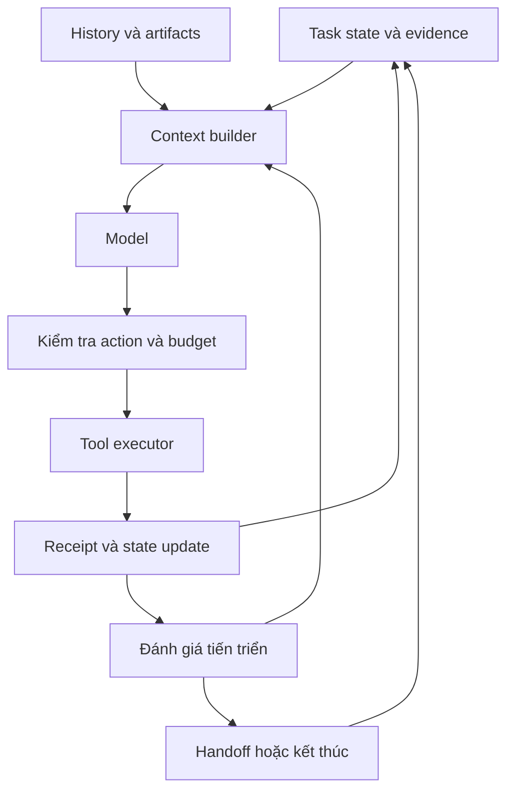

# Tổng hợp cải tiến context engineering

# Phân tích Root Causes của Raptix AI Agent

<text color="secondary" size="sm">Dựa trên CONTEXT_AUDIT.md · Raptix codebase · Silentium là môi trường lab kiểm thử</text>

Tôi đã xem báo cáo audit, bao gồm các cơ chế runtime, thống kê 1.115 model calls, luồng compaction, cách tổ chức subagents và các kiểm chứng offline.

## 1. Kết luận quan trọng nhất

**Raptix không đơn thuần gặp vấn đề context quá dài. Hệ thống có vấn đề về tính toàn vẹn trạng thái (state integrity), vòng đời context (context lifecycle) và khả năng kiểm soát tiến trình thực thi của agent.**

Tôi phân biệt ba cấp độ vấn đề:

1. **Lỗi correctness:** context của một worker có thể làm hỏng context của orchestrator. Đây là lỗi thực sự được xác nhận bằng code, synthetic reproduction và log Silentium.
2. **Nghẽn về hiệu quả:** historical tool interactions tích lũy qua hàng trăm calls, khiến mỗi bước reasoning phải xử lý lượng context lớn, dù kết quả mỗi tool call tương đối nhỏ.
3. **Nghẽn về điều khiển agent:** giới hạn thực thi chủ yếu dựa trên số bước, dispatch và ngân sách, chưa trực tiếp phản ánh agent có đang tạo ra tiến triển có ý nghĩa hay không.

Điểm đáng chú ý nhất: **lỗi nghiêm trọng nhất không phải caching, mà là cross-agent state leakage xảy ra khi child worker compaction.** <FileCite ref="turn0file0" line_range_start={65} line_range_end={86}/>

### Bảng xếp hạng các điểm nghẽn

<text color="secondary" size="xs">Thứ tự dưới đây là đánh giá của tôi về mức độ ảnh hưởng đến tính đúng đắn và vận hành, không phải thứ hạng tiết kiệm token đã được đo bằng A/B test.</text>

| Mức độ | Điểm nghẽn | Tình trạng bằng chứng |
|---|---|---|
| <text color="danger" weight="medium">P0 - Critical</text> | Child compaction làm nhiễm context của orchestrator | Code + reproduced + run |
| <text color="danger" weight="medium">P0 - Critical</text> | History offload không tạo được recovery pointer trong run | Run xác nhận; root cause cụ thể chưa được xác minh hết |
| <text color="danger" weight="medium">P0 - Critical</text> | Compaction/overflow failure handling không bảo toàn đầy đủ ngữ nghĩa lỗi | Code + synthetic reproduction |
| <text weight="medium">P1 - High</text> | Context phình to do lịch sử tool và system prompt lặp lại | Code + run statistics |
| <text weight="medium">P1 - High</text> | Worker chạy dài nhưng thiếu giới hạn dựa trên semantic progress | Code + run evidence |
| <text weight="medium">P1 - High</text> | Skill deduplication có lifecycle không khớp với context | Code |
| <text weight="medium">P1 - High</text> | State, KG và handoff không bảo đảm đồng bộ đầy đủ | Code; một phần chưa có run evidence |
| <text color="secondary" weight="medium">Chưa xác định</text> | Actual provider caching và billable-token waste | Thiếu upstream telemetry |

Báo cáo cũng sửa một số nhận định ban đầu: không có bằng chứng về tám lần sinh summary độc lập, không có bằng chứng caching bằng 0, và compaction không được chứng minh là xóa vĩnh viễn raw history. <FileCite ref="turn0file0" line_range_start={49} line_range_end={63}/>

---

## 2. Điểm nghẽn số 1 - Cross-agent state leakage

<text color="danger" weight="medium" size="sm">Critical correctness bug · Confirmed & reproduced</text>

Đây là phát hiện quan trọng nhất trong toàn bộ báo cáo.

### Điều gì thực sự xảy ra?

Raptix sử dụng mô hình orchestrator gọi các child workers như `recon`, `exploit`, `postexploit`.

Mỗi child có conversation riêng, nhưng trong cơ chế streaming hiện tại, **private state của child có thể bị đưa ngược về parent**.

<box border radius="lg" padding={3} gap={2}>
  <box background="surface-secondary" radius="md" padding={3} align="center" gap={1}>
    **Postexploit Worker**
    <text size="xs" color="secondary">Sinh `_summarization_event` cho history của chính worker</text>
  </box>
  <row justify="center">
    <icon name="arrow-down" color="secondary"/>
  </row>
  <box border={{size:1,color:"danger"}} radius="md" padding={3} align="center" gap={1}>
    <text color="danger" weight="medium">StreamingRunnable</text>
    <text size="xs" textAlign="center">Trả last full state thay vì projected public state</text>
  </box>
  <row justify="center">
    <icon name="arrow-down" color="secondary"/>
  </row>
  <box background="surface-secondary" radius="md" padding={3} align="center" gap={1}>
    **DeepAgents task + Dispatch**
    <text size="xs" color="secondary">Không lọc `_summarization_event`</text>
  </box>
  <row justify="center">
    <icon name="arrow-down" color="danger"/>
  </row>
  <box border={{size:1,color:"danger"}} radius="md" padding={3} align="center" gap={1}>
    <text color="danger" weight="medium">Raptix Orchestrator</text>
    <text size="xs" textAlign="center">Áp dụng summary và cutoff của postexploit lên history của parent</text>
  </box>
</box>

### Bằng chứng trực tiếp trong Silentium

- Postexploit phát sinh summary, được quan sát ở record line 1307.
- `task()` trả `_summarization_event` về orchestrator tại line 1407.
- Parent bắt đầu dùng chính summary đó tại line 1408.
- SHA-256 của summary trong hai vị trí trùng nhau hoàn toàn.
- Parent áp dụng `cutoff_index=162` lên conversation chỉ có 148-160 messages, khiến effective context bị thu lại thành một summary duy nhất.

Điều này được xác nhận bằng synthetic StateGraph chạy qua wrapper và task tool thực tế, không chỉ là suy đoán từ log. <FileCite ref="turn0file0" line_range_start={90} line_range_end={141}/>

### Vì sao lỗi này nghiêm trọng?

Có ba hậu quả.

**Một là mất tính độc lập giữa agents.** Summary vốn chỉ có ý nghĩa trong lịch sử postexploit lại được sử dụng để thay thế lịch sử của orchestrator.

**Hai là mất khả năng quan sát tiến trình.** Parent có thể không còn thấy các kết quả tool hoặc quyết định của chính mình trong effective context, mặc dù raw checkpoint vẫn có thể giữ chúng.

**Ba là agent có thể reasoning trên trạng thái sai.** Đây không chỉ là trường hợp thiếu context; context còn có thể chứa một bản tóm tắt thuộc về agent khác.

Nói cách khác:

**Raptix đang có một lỗi vi phạm ranh giới sở hữu trạng thái giữa parent và child.**

Đây là nguyên nhân đã xác minh được cho sự sụp đổ context của orchestrator trong run Silentium, nhưng chưa đủ dữ liệu để quy toàn bộ recursion failures hoặc nhiệm vụ không hoàn thành cho lỗi này.

## 3. Điểm nghẽn số 2 - Compaction có thực hiện, nhưng recovery path không hoạt động đúng

<text color="danger" weight="medium" size="sm">Critical context lifecycle defect</text>

Điểm này cần phân biệt hai cơ chế:

- **Compaction:** rút gọn history mà LLM được nhìn thấy.
- **History offloading:** lưu history bên ngoài context, cho phép agent tìm lại thông tin đã loại khỏi prompt.

Trong thiết kế hiện tại của Raptix, hai cơ chế này phải phối hợp với nhau. Tuy nhiên, run Silentium cho thấy chúng không hoạt động đầy đủ.

### Cơ chế ở code

`create_summarization_middleware` nhận backend được tạo lúc xây dựng agent.

DeepAgents sử dụng đường dẫn:

`/conversation_history/{thread_id}.md`

Trong khi sandbox có engagement fence yêu cầu filesystem operations nằm trong `/workspace`.

Khi việc ghi history không thành công, middleware có thể tiếp tục tạo summary mà không có `file_path` trỏ tới lịch sử đã lưu.

Báo cáo xác nhận summary trong Silentium không có history pointer. Sự không tương thích giữa đường dẫn và sandbox fence là lời giải thích hợp lý từ code, nhưng chưa có HTTP response lịch sử để xác nhận nguyên nhân trực tiếp của lần ghi thất bại. <FileCite ref="turn0file0" line_range_start={201} line_range_end={240}/>

### Hậu quả thực sự

Giả sử worker có 166 messages. Sau compaction, LLM chỉ nhìn thấy summary cùng một số messages gần nhất.

Nhưng:

- Raw state có thể vẫn được LangGraph checkpoint lưu.
- Runtime recorder có thể còn bản ghi.
- Agent không có một đường dẫn filesystem hợp lệ để chủ động đọc lại toàn bộ history đã bị loại khỏi context.

Đây là sự khác biệt rất lớn.

**Raptix không nhất thiết mất dữ liệu, nhưng có thể mất khả năng để agent truy cập dữ liệu đó.**

Có thể gọi đây là *model-visible information accessibility failure*, thay vì permanent data loss.

### Một điểm liên quan: compaction không có kiểm tra fidelity theo cấu trúc

Summary được yêu cầu chứa:

- `SESSION INTENT`
- `SUMMARY`
- `ARTIFACTS`
- `NEXT STEPS`

Prompt cũng yêu cầu giữ các phương án đã bác bỏ và lý do.

Như vậy hệ thống đã có ý thức bảo toàn lịch sử quyết định. Tuy nhiên, summary vẫn là văn bản tự do, không có schema validation đối với những thông tin như verified state, unresolved assumptions, failed attempts hay quan hệ phụ thuộc giữa các bước. <FileCite ref="turn0file0" line_range_start={243} line_range_end={255}/>

Do đó, ngay cả khi summary hợp lệ về định dạng, **chưa có bằng chứng rằng nó bảo toàn đầy đủ những thông tin cần thiết để tiếp tục tác vụ**.

Tôi không kết luận summary cụ thể của Silentium đã bỏ mất bao nhiêu thông tin quan trọng, vì file audit chưa có phép đo semantic fidelity ở mức đó.

---

## 4. Điểm nghẽn số 3 - Compaction failure handling có thể làm suy giảm độ tin cậy

<text color="danger" weight="medium" size="sm">Confirmed code defect · Run impact chưa định lượng</text>

Tôi thấy ba vấn đề độc lập nhưng liên quan với nhau.

### 4.1. Summary generation thất bại vẫn có thể tạo ra summary giả

Trong LangChain helper, exception khi sinh summary có thể bị bắt và chuyển thành một chuỗi văn bản dạng:

`Error generating summary: ...`

Chuỗi này có thể tiếp tục được xử lý như một summary thông thường.

Điều đó có nghĩa: một lỗi infrastructure có thể bị chuyển thành nội dung trong context của agent.

Nếu event chứa chuỗi lỗi được commit, agent có thể nhận một summary không mang thông tin của lịch sử trước đó.

Đây là lỗi về **tính toàn vẹn dữ liệu tại ranh giới giữa error handling và memory management**.

### 4.2. Context overflow không được bảo toàn đúng exception type

Dependency có nhánh xử lý `ContextOverflowError`, nhưng lớp `_ProxiedChatOpenAI` của Raptix chuyển lỗi HTTP 400 thành `RuntimeError` trong nhánh tổng quát.

Synthetic probe đã xác nhận exception không còn giữ type `ContextOverflowError`.

Do đó, cơ chế ứng phó overflow ở middleware không thể được mặc định coi là còn hoạt động đúng qua transport hiện tại.

### 4.3. Safe proxy có thể gọi lại downstream handler

`_SafeSummarizationProxy` bắt exception rộng, sau đó có thể gọi lại `handler(request)`.

Vì vậy một downstream failure có thể dẫn đến việc thử lại ở ranh giới middleware mà không có đủ thông tin để phân biệt với quá trình recovery thực sự.

Chưa có bằng chứng rằng những request đó đều được upstream xử lý hoặc tính phí hai lần.

Cả ba cơ chế đều được mô tả trong audit, và riêng việc mất type overflow đã được reproduced. <FileCite ref="turn0file0" line_range_start={257} line_range_end={283}/>

**Nhận định:** Compaction hiện không chỉ có rủi ro mất thông tin khi tóm tắt, mà còn có rủi ro làm sai lệch trạng thái khi chính quá trình tóm tắt hoặc model invocation gặp lỗi.

---

## 5. Điểm nghẽn số 4 - Chi phí context chủ yếu nằm trong accumulated history

<text weight="medium" size="sm">Confirmed runtime inefficiency</text>

Đây là vấn đề hiệu năng có bằng chứng định lượng rõ nhất.

### Phân bổ token theo agent

<box border radius="lg" padding={3} gap={2}>
  <text weight="medium">58,35 triệu recorded input tokens</text>
  <Chart content={{"chartType":"bar","meta":{"footer":"Số liệu từ audit Silentium; không bao gồm model invocations ngoài recorder."},"xKey":"agent","series":[{"dataKey":"tokens","label":"Input tokens","valueFormat":"compact"}],"yAxisMin":0,"layout":"vertical","data":[{"agent":"Postexploit","tokens":39305746},{"agent":"Exploit","tokens":11282659},{"agent":"Raptix","tokens":4248634},{"agent":"Recon","tokens":3515061}]}}/>
  <grid columns={3} gap={2}>
    <grid-item>
      <box gap={1}>
        <text color="secondary" size="xs">Postexploit calls</text>
        <title size="lg" tabularNums>720</title>
      </box>
    </grid-item>
    <grid-item>
      <box gap={1}>
        <text color="secondary" size="xs">Postexploit input</text>
        <title size="lg" tabularNums>39,3M</title>
      </box>
    </grid-item>
    <grid-item>
      <box gap={1}>
        <text color="secondary" size="xs">Tỷ trọng input</text>
        <title size="lg" tabularNums>67,4%</title>
      </box>
    </grid-item>
  </grid>
  <caption>Nguồn: số liệu recomputed của báo cáo audit. <FileCite ref="turn0file0" line_range_start={768} line_range_end={785}/></caption>
</box>

Một chi tiết rất quan trọng: postexploit là phần tiêu thụ tổng input lớn nhất **không phải vì mỗi call của nó lớn nhất**.

| Agent | Model calls | Input trung bình/call |
|---|---:|---:|
| Exploit | 178 | 63.385 |
| Postexploit | 720 | 54.591 |
| Recon | 89 | 39.495 |
| Raptix | 128 | 33.192 |

Exploit thực tế có input trung bình cao hơn postexploit.

Postexploit chiếm ưu thế về tổng chi phí vì thực hiện quá nhiều model calls có context tương đối lớn.

Do đó, có hai yếu tố nhân nhau:

$$
\text{Total Input}=\sum_{i=1}^{N}\text{Context Tokens}_i
$$

Ở postexploit, cả $N$ và kích thước context đều đáng kể. Không thể giải thích tổng chi phí chỉ bằng context size hoặc chỉ bằng số bước.

### Context đang chứa những gì?

Báo cáo phân loại toàn bộ nội dung văn bản xuất hiện lặp lại trong các model requests.

<box border radius="lg" padding={3} gap={2}>
  <text weight="medium">Thành phần trong recorded context</text>
  <Chart content={{"chartType":"bar","meta":{"footer":"Tỷ trọng theo số ký tự cộng dồn, KHÔNG phải tỷ trọng billed tokens."},"xKey":"component","series":[{"dataKey":"share","label":"Character share","valueSuffix":"%"}],"yAxisMin":0,"layout":"vertical","data":[{"component":"Bash results","share":40.45},{"component":"System text","share":28.28},{"component":"AI tool-call JSON","share":15.93},{"component":"Loaded skills","share":4.17},{"component":"File reads","share":3.84},{"component":"Human/reminders","share":2.45},{"component":"AI prose","share":1.89},{"component":"Other","share":2.99}]}}/>
  <caption>Dựa trên phép phân loại ký tự, chưa gồm tool schemas và provider wire formatting. <FileCite ref="turn0file0" line_range_start={787} line_range_end={812}/></caption>
</box>

Có hai phát hiện quan trọng.

**Phát hiện 1: history của tool interactions mới là thành phần nổi bật nhất.**

`bash ToolMessage` và `AI tool-call JSON` cộng lại chiếm khoảng 56,4% số ký tự được phân loại.

Trong top 20 requests lớn nhất, tất cả thuộc postexploit, riêng bash results đã chiếm khoảng 73,9-85,8% lượng ký tự của từng request.

Đây là dấu hiệu rất mạnh rằng context đang mang theo một lượng lớn dấu vết thực thi trước đó, không chỉ những thông tin cần cho quyết định hiện tại.

**Phát hiện 2: system prompt cũng là một recurring cost đáng kể.**

System text chiếm 28,28% ký tự cộng dồn. Ở postexploit, complete system text có trung bình khoảng 43.506 ký tự.

Nhưng phần này không phải history tích lũy. Nó là chi phí nền được gắn vào các calls.

Chính sự kết hợp giữa **system overhead tương đối cố định** và **historical tool content tăng dần** tạo ra mức input cao liên tục.

### Tại sao giới hạn output từng tool không giải quyết vấn đề?

Audit ghi nhận 856 bash tool-call entries, với response trung vị chỉ 723 ký tự và p90 là 9.432 ký tự. <FileCite ref="turn0file0" line_range_start={392} line_range_end={416}/>

Các output riêng lẻ không quá lớn. Tuy nhiên, mỗi lần agent gọi model, những output lịch sử còn nằm trong effective context lại được đưa vào request.

Một output nhỏ có thể xuất hiện trong nhiều request kế tiếp.

Đây là **cumulative history amplification**: chi phí của một observation không chỉ phát sinh lúc nó được tạo, mà còn lặp lại trong các lượt reasoning sau đó.

Nó giải thích trực tiếp tại sao hệ thống vẫn tiêu thụ lượng context lớn dù đã kiểm soát kích thước mỗi tool response.

## 6. Điểm nghẽn số 5 - Agent không có cơ chế kiểm soát semantic progress đầy đủ

<text weight="medium" size="sm">High impact · Confirmed architectural limitation</text>

Đây là vấn đề liên quan trực tiếp đến năng lực tự chủ của Raptix.

### Hệ thống đang giới hạn cái gì?

| Mechanism | Thực sự kiểm soát |
|---|---|
| `recursion_limit` | Số graph super-steps |
| `DispatchMiddleware` | Dispatch intents, duplicate in-flight, repeated terminal failures |
| `BudgetEnforcementMiddleware` | Ngân sách chi tiêu khi được bật |
| `CompletionSpec.max_steps` | Số bước trong `BoundedWorkerRunner`, không phải giới hạn chung của standard-agent `task()` |
| Model timeout/output limit | Thời gian và output của một request |

Những giới hạn này không trực tiếp trả lời câu hỏi:

**Sau 20 bước hành động, agent đã tiến gần mục tiêu hơn hay chưa?**

Báo cáo xác nhận dispatch ledger có thể ngăn một số tình huống lặp, nhưng không giới hạn được chuỗi hành động thay đổi liên tục trong cùng một dispatch dù không tạo ra tiến triển. <FileCite ref="turn0file0" line_range_start={637} line_range_end={658}/>

### Phân tích đoạn exploration tiêu thụ nhiều token

Trong khoảng 17:12-17:18:46, postexploit ghi nhận:

<grid columns={3} gap={2}>
  <grid-item>
    <box background="surface-secondary" radius="lg" padding={3} gap={1}>
      <text color="secondary" size="xs">Model calls</text>
      <title size="xl" color="default" tabularNums>114</title>
    </box>
  </grid-item>
  <grid-item>
    <box background="surface-secondary" radius="lg" padding={3} gap={1}>
      <text color="secondary" size="xs">Input tokens</text>
      <title size="xl" color="default" tabularNums>9,33M</title>
    </box>
  </grid-item>
  <grid-item>
    <box background="surface-secondary" radius="lg" padding={3} gap={1}>
      <text color="secondary" size="xs">Tỷ trọng run</text>
      <title size="xl" color="default" tabularNums>16%</title>
    </box>
  </grid-item>
</grid>

Các model responses trong đoạn này phát ra 109 bash calls và 6 write_file calls. <FileCite ref="turn0file0" line_range_start={753} line_range_end={766}/>

Đây là một đoạn execution có chi phí rất lớn trong thời gian ngắn.

Tuy nhiên, từ số liệu hiện có, chưa thể phân loại chính xác các calls thành:

- Bước tạo ra bằng chứng hoặc tiến triển mới.
- Bước xác minh cần thiết.
- Retry hợp lệ do trạng thái môi trường thay đổi.
- Bước khám phá thất bại nhưng cung cấp kiến thức có ích.
- Bước lặp lại không đem lại tiến triển.

Đây là điểm thiếu quan trọng trong cách Raptix đo hoạt động.

**Hệ thống quan sát được số lần agent hành động, nhưng chưa chứng minh được có đủ tín hiệu để đánh giá chất lượng tiến triển của từng chuỗi hành động.**

### Về 104 duplicate bash và 95 CAPTCHA/OCR calls

Báo cáo mới đã thu hẹp đáng kể kết luận cũ:

- Chỉ có **6 bash entries dư ra** trùng toàn bộ arguments và tên agent theo phép so khớp nghiêm ngặt.
- Có **167 tool entries** khớp từ khóa CAPTCHA/OCR, không đồng nghĩa 167 lần thử cùng một chiến lược.
- Không đủ bằng chứng để khẳng định toàn bộ 104 trường hợp ban đầu đều dư thừa.

Điều này không loại trừ loop waste. Nó chỉ cho thấy số lượng hành động lặp có hại **chưa được đo chính xác**. <FileCite ref="turn0file0" line_range_start={407} line_range_end={416}/>

### Lưu ý về 720 postexploit calls

720 model entries là thống kê tổng hợp của role postexploit. Audit ghi nhận **7 lần gọi `task()` tới postexploit**, không chứng minh một worker instance duy nhất đã thực hiện 720 model calls.

Điều này quan trọng vì phải phân biệt:

- Worker đơn lẻ sống quá lâu.
- Nhiều dispatch tới cùng một loại worker.
- Context và middleware được tái sử dụng giữa các dispatch.

Các trường hợp trên có nguyên nhân và hành vi khác nhau. <FileCite ref="turn0file0" line_range_start={628} line_range_end={635}/>

---

## 7. Điểm nghẽn số 6 - Lifecycle của memory, skill và worker không nhất quán

<text weight="medium" size="sm">Confirmed code-level architectural defect</text>

### 7.1. Skill deduplication tồn tại lâu hơn conversation

Raptix giữ `loaded_keys` trong closure của middleware instance.

Trong khi đó, child graphs được xây dựng một lần rồi tái sử dụng cho nhiều dispatches.

Điều này tạo ra tình huống:

1. Worker A load một skill.
2. Middleware đánh dấu skill đã được load.
3. Worker B bắt đầu với conversation mới nhưng dùng lại middleware instance.
4. Worker B yêu cầu load skill.
5. Middleware có thể trả về thông báo skill đã nằm trong context, dù thực tế conversation mới chưa nhận nội dung đó.

Tương tự, sau compaction, skill có thể không còn trong effective context nhưng dedupe state vẫn cho rằng skill đã được load.

Đây là **memory visibility mismatch**: bộ phận theo dõi nội dung đã load không phản ánh đúng thông tin mà model đang nhìn thấy.

Cơ chế này đã được xác nhận ở code, nhưng báo cáo chưa định lượng số lần gây lỗi thực tế trong Silentium. <FileCite ref="turn0file0" line_range_start={553} line_range_end={570}/>

### 7.2. Handoff chưa có bảo đảm về tính đầy đủ của state

Một dispatch mới khởi tạo conversation bằng một `HumanMessage` chứa task description.

Worker có thể nhận thêm thông tin từ files, shared state hoặc các context overlays tùy cấu hình, nhưng việc đó không đồng nghĩa với việc tất cả trạng thái quan trọng đã được chuyển giao.

Một số điểm đáng chú ý:

- KG và OPPLAN không có mặt ở tất cả child roles.
- KG không phải bản ghi đầy đủ mọi hành động và thất bại.
- Standard `task` boundary chưa bảo đảm một validated mid-life handoff bundle.
- Dispatch được đánh dấu thành công khi không gặp captured exception, không phải vì mục tiêu đã được xác minh hoàn thành.

<FileCite ref="turn0file0" line_range_start={572} line_range_end={600}/>

Như vậy, Raptix có các thành phần của một stateful agent system, nhưng **chưa có bằng chứng về một hợp đồng nhất quán bảo đảm worker luôn nhận đủ trạng thái cần thiết để tiếp tục nhiệm vụ**.

### 7.3. KG không tương đương với bộ nhớ sự thật đã được xác minh

KG có persistence và revision tracking, nhưng view được inject vào prompt chỉ là một projection giới hạn.

Báo cáo ghi nhận:

- Generic KG observation không bắt buộc có `confidence` hay `verified_status`.
- Danh sách vulnerabilities lấy tối đa 20 rows rồi mới sort severity, nên không bảo đảm chọn global top five.
- Planning paths ưu tiên hop count, không phải chi phí hay rủi ro thực tế.
- Chưa tìm thấy production scheduler tự động loại bỏ stale nodes trong cơ chế được audit.

<FileCite ref="turn0file0" line_range_start={517} line_range_end={550}/>

Vì vậy, KG có thể hỗ trợ context retrieval, nhưng chưa thể coi projection của nó là một nguồn đầy đủ và luôn cập nhật về trạng thái thực tế.

Đây là rủi ro về **memory fidelity và information selection**, chưa phải bằng chứng KG đã khiến Silentium ra quyết định sai.

---

## 8. Điểm nghẽn số 7 - Runtime observability chưa đủ để quy trách nhiệm chính xác

Đây là vấn đề khiến một số chẩn đoán ban đầu bị sai.

### 8.1. Không biết chính xác provider đã sử dụng caching như thế nào

Báo cáo xác nhận `AnthropicPromptCachingMiddleware` không chạy với factory-created `ChatOpenAI` subclasses.

Nhưng không thể kết luận inference backend không có KV/prefix caching.

Dữ liệu hiện tại chỉ chứng minh:

- Cả 1.115 recorded model entries có usage metadata.
- `input_token_details` rỗng.
- Không có raw upstream usage đủ để xác định cached tokens.
- Chưa có billing evidence đầy đủ.

Trong khi đó, complete system payload của postexploit giống hệt giữa các model entries kề nhau tới **99,86%** theo cách đo của báo cáo. <FileCite ref="turn0file0" line_range_start={314} line_range_end={343}/><FileCite ref="turn0file0" line_range_start={418} line_range_end={438}/>

Điều này cho thấy prefix có tính ổn định cao, nhưng không chứng minh cache đã hit hoặc miss.

**58,35 triệu input tokens là reported usage, không đồng nghĩa chắc chắn với 58,35 triệu uncached billable tokens.**

### 8.2. Recorder không bao phủ toàn bộ các model invocations

Summary generation sử dụng direct model invocation ngoài model-handler recorder.

Thêm vào đó, có nhiều lớp retry:

- Client SDK.
- LiteLLM completion.
- LiteLLM router.
- Agent model fallback.
- Summarization proxy.
- Dispatch-level retry.

Một recorded model call không nhất thiết bằng một upstream inference attempt.

Vì vậy:

**1.115 là số model-handler entries được ghi nhận, không phải tổng số provider requests chắc chắn đã xảy ra.**

Số attempts thực tế, số summary calls và tổng billing vẫn chưa xác định. <FileCite ref="turn0file0" line_range_start={479} line_range_end={505}/>

### 8.3. Có lỗi không xuất hiện dưới dạng recorder exception

Audit tìm được:

- 19 `ToolMessage` có `status="error"`.
- Recursion failures trong graph logs.
- Không có recorder entries mang exception `type="error"`.

Đây không phải mâu thuẫn. Các loại lỗi được ghi nhận ở các lớp khác nhau.

Nói cách khác, nếu đánh giá reliability chỉ dựa trên exception records của model-handler, hệ thống sẽ bỏ sót một số thất bại trong execution. <FileCite ref="turn0file0" line_range_start={770} line_range_end={785}/>

Một rủi ro vận hành bổ sung là recorder lưu raw request/response có chứa thông tin nhạy cảm. Với workload red team, đây là vấn đề về phạm vi truy cập và vòng đời dữ liệu, dù không phải nguyên nhân trực tiếp gây context growth. <FileCite ref="turn0file0" line_range_start={679} line_range_end={708}/>

---

## 9. Những giả thuyết trước đây không còn đủ bằng chứng

Bảng này quan trọng vì tránh nhầm triệu chứng với root cause.

| Giả thuyết ban đầu | Kết luận sau audit |
|---|---|
| Không có prompt caching nên toàn bộ 58M tokens bị re-bill | **Chưa xác minh** được cache/billing |
| Có 8 lần compaction độc lập làm mất history | Báo cáo xác nhận **một summary riêng biệt được quan sát**, sau đó lan sang parent; tổng số attempts chưa biết |
| Compaction xóa vĩnh viễn dữ liệu | Không được chứng minh; raw message state vẫn được giữ trong cơ chế được kiểm tra |
| Summarizer chỉ đọc 4K tokens | Sai với factory path hiện tại; selected batch không chịu helper trim 4K |
| 104 bash commands chắc chắn dư thừa | Chưa được xác minh; chỉ 6 surplus entries trùng exact arguments |
| `recursion_limit=400` tương ứng 400 model calls | Sai; đây là graph super-step limit |
| 720 postexploit calls do một worker sống quá lâu | Không đủ bằng chứng để quy cho một worker instance |
| Tool outputs quá lớn là nguyên nhân chính | Không phù hợp với dữ liệu; vấn đề chủ yếu là nội dung lịch sử tích lũy và tái xuất hiện trong các requests |

Các điều chỉnh này dựa trên phần revalidation và phân tích thống kê của báo cáo. <FileCite ref="turn0file0" line_range_start={49} line_range_end={63}/><FileCite ref="turn0file0" line_range_start={735} line_range_end={751}/>

---

## 10. Mối quan hệ nhân quả giữa các điểm nghẽn

Dựa trên kết quả audit, có thể biểu diễn vấn đề Raptix thành ba chuỗi riêng biệt.

<box gap={2}>
  <box border radius="lg" padding={3} gap={2}>
    <text weight="medium">Chuỗi A - Context correctness</text>
    <box background="surface-secondary" radius="md" padding={2}>
      <text size="sm" textAlign="center">Child compaction → Private event leakage → Parent projection collapse</text>
    </box>
    <row gap={2} align="center">
      <icon name="check-circle-2" color="success"/>
      <text size="xs" color="secondary">Chuỗi nhân quả được xác nhận bằng code, offline reproduction và Silentium logs.</text>
    </row>
  </box>
  <box border radius="lg" padding={3} gap={2}>
    <text weight="medium">Chuỗi B - Context cost amplification</text>
    <box background="surface-secondary" radius="md" padding={2}>
      <text size="sm" textAlign="center">Persistent history + recurring prompt → Large model inputs × many calls</text>
    </box>
    <row gap={2} align="center">
      <icon name="check-circle-2" color="success"/>
      <text size="xs" color="secondary">Được hỗ trợ bởi thống kê token và character attribution; billed cache cost chưa xác định.</text>
    </row>
  </box>
  <box border radius="lg" padding={3} gap={2}>
    <text weight="medium">Chuỗi C - Autonomous progress reliability</text>
    <box background="surface-secondary" radius="md" padding={2}>
      <text size="sm" textAlign="center">Execution without semantic-progress bounds → Long exploration → Greater context and step consumption</text>
    </box>
    <row gap={2} align="center">
      <icon name="alert-circle" color="secondary"/>
      <text size="xs" color="secondary">Cơ chế giới hạn được xác nhận; mức token thực sự lãng phí và tác động đến task success chưa định lượng.</text>
    </row>
  </box>
</box>

Các chuỗi có thể tương tác với nhau. Ví dụ, nếu agent thiếu thông tin sau compaction, nó có thể phải tìm lại evidence và tiêu thụ nhiều bước hơn. Tuy nhiên, **audit hiện chưa chứng minh được phần nào của 58,35M tokens do cơ chế đó trực tiếp gây ra**.

Đặc biệt, 10 surplus equal-hash parent calls sau collapse tương ứng 140.420 recorded input tokens, nhưng không thể từ đó suy ra toàn bộ 39,3M tokens ở postexploit đều có nguồn gốc từ state leakage. <FileCite ref="turn0file0" line_range_start={735} line_range_end={751}/>

## 11. Phân biệt điểm nghẽn đã xác minh và tác động còn chưa biết

| Vấn đề | Có bằng chứng lỗi cơ chế? | Có bằng chứng xuất hiện trong Silentium? | Đã định lượng tác động lên task success? |
|---|---|---|---|
| Cross-agent summary leakage | Có | Có | Chưa |
| History offload không có pointer | Có cơ chế lỗi khả dĩ | Có, thiếu pointer | Chưa |
| Summary error handling | Có | Chưa rõ | Chưa |
| Overflow exception translation | Có, reproduced | Chưa rõ | Chưa |
| Historical context amplification | Có | Có | Đã đo lượng context, chưa đo tác động lên success |
| Semantic-progress limitations | Có | Có exploration dài | Chưa |
| Skill dedupe lifecycle mismatch | Có | Chưa định lượng | Chưa |
| KG projection limitations | Có | Chưa xác định | Chưa |
| Provider cache inefficiency | Chưa xác minh | Không đủ telemetry | Chưa |

Phân biệt này cũng phản ánh giới hạn của tài liệu: code được revalidate ở branch `structure`, HEAD `be5c9db`, còn Silentium là run lịch sử ngày 07/10/2026. Báo cáo không khẳng định checkout hiện tại giống từng byte với môi trường đã thực thi. <FileCite ref="turn0file0" line_range_start={1} line_range_end={47}/>

---

## 12. Đánh giá cuối cùng

Tôi cho rằng Raptix đang có **ba vấn đề gốc quan trọng nhất**, nhưng chúng ảnh hưởng đến ba khía cạnh khác nhau.

**Về correctness:** vấn đề nghiêm trọng nhất là các ranh giới state giữa orchestrator, child worker và summarization middleware không được bảo toàn. Đây là lỗi có bằng chứng mạnh nhất, có khả năng dẫn đến việc agent reasoning trên context của sai conversation.

**Về token consumption:** nguyên nhân nổi bật nhất là accumulated tool history cộng với recurring prompt overhead trong một quá trình có số lượng model calls lớn. Postexploit đóng góp 67,4% reported input tokens vì cả số calls và context size đều cao. Chưa đủ bằng chứng để khẳng định caching là nguyên nhân chi phí lớn nhất.

**Về long-horizon autonomy:** điểm yếu kiến trúc là việc thực thi, compaction, handoff, knowledge state và kiểm soát tiến triển chưa tạo thành một cơ chế thống nhất, có thể kiểm chứng được. Raptix có các thành phần lưu trạng thái, nhưng chưa có bằng chứng chúng bảo đảm được tính liên tục ngữ nghĩa của nhiệm vụ qua mọi lifecycle transition.

Nếu cô đọng thành một nhận định:

**Raptix đã có persistence, orchestration, memory và context compaction; điểm nghẽn sâu hơn là hệ thống chưa bảo đảm tính nhất quán giữa trạng thái được lưu, trạng thái được chuyển giao và trạng thái mà LLM thực sự nhìn thấy.**

Đồng thời, một lượng lớn context lịch sử tiếp tục được xử lý qua các model calls mà chưa có cơ chế đo semantic progress đủ tốt để xác định phần chi phí nào thực sự đóng góp vào kết quả.

Đó là hai vấn đề trung tâm tôi rút ra từ audit: **Context Integrity** và **Context Efficiency**. Vấn đề thứ ba, **Autonomous Progress Control**, quyết định liệu agent có thể hoạt động dài hạn một cách ổn định và hiệu quả hay không.

Tôi dừng ở phần chẩn đoán nguyên nhân, chưa đưa ra phương án thay đổi kiến trúc hay giải pháp triển khai.

## Prompt:
08/10/2026, 10:37:48

dựa trên toàn bộ các phân tích về điểm yếu của raptix đã nêu trên, tiến hành đề xuất hướng giải quyết triệt để các vấn đề đó

## Response:
08/10/2026, 10:37:49 · gpt-6-astra-wm

Tôi sẽ tách đề xuất thành ba phần: sửa các lỗi đã có bằng chứng, củng cố vòng đời state/context, và kiểm chứng hiệu quả. Với caching, chi phí vòng lặp và chất lượng summary, tôi sẽ giữ rõ giới hạn bằng chứng để tránh tối ưu dựa trên giả định.

> **Worked**
>
> 
>
> **Searched the web**
>
> 
>
> Worked for 41s

**Hướng giải quyết triệt để cho Raptix là xây dựng một hợp đồng nhất quán giữa trạng thái nhiệm vụ, thực thi tools và context mà model nhìn thấy.** Compaction, handoff, KG, skill loading và retry phải tuân theo hợp đồng đó.

Tôi đề xuất triển khai theo thứ tự: **sửa lỗi toàn vẹn state → bảo đảm khả năng phục hồi → kiểm soát tiến triển → tối ưu context và caching**. Instrumentation cần bắt đầu ngay để đo được tác động của từng thay đổi.

Các đề xuất dưới đây dựa trên phân tích audit bạn đã cung cấp; tôi chưa kiểm tra lại repository trong lượt này. Tài liệu framework được đối chiếu để xác nhận cơ chế thiết kế, không dùng để khẳng định phiên bản Raptix hiện tại đã có hoặc đã sửa tính năng nào.

**1. Xác lập các điều kiện bắt buộc của runtime**

Trước khi sửa từng middleware, cần thống nhất những điều hệ thống phải luôn bảo đảm:

| Điều kiện | Ý nghĩa trong Raptix |
|---|---|
| State có chủ sở hữu rõ ràng | Child không được sửa private context state của parent |
| Tiến độ được lưu độc lập với hội thoại | Xóa model-visible history không xóa trạng thái công việc |
| Hoàn thành phải có bằng chứng | Tool không ném exception chưa đủ để xác nhận mục tiêu đã đạt |
| Compaction có thể phục hồi | Nội dung bị rút khỏi context phải có nguồn truy xuất hợp lệ |
| Context phản ánh đúng phiên bản state | Không kết hợp summary cũ, KG mới và task state không tương thích mà không biết |
| Retry và handoff không đặt lại giới hạn | Đổi worker không làm mất số lần thử, chi phí và thất bại trước đó |
| Không chắc tool đã thực thi thì phải đối soát | Không tự động chạy lại một hành động có side effects chỉ vì thiếu response |

Đây cũng là các điều kiện nghiệm thu. “Agent có vẻ chạy tốt hơn” không đủ để đóng các lỗi correctness.

**2. Sửa tận gốc ranh giới parent-child**

Với lỗi `_summarization_event`, chỉ thêm một dòng lọc field sẽ xử lý triệu chứng hiện tại nhưng vẫn để ngỏ khả năng các private fields khác bị đưa sang parent.

Thiết kế nên có **ba schema riêng**:

| Schema | Nội dung |
|---|---|
| `WorkerInput` | Task ID, mục tiêu, constraints, state revision, evidence references, budget được cấp |
| `WorkerPrivateState` | Messages, compaction events, context manifest, middleware state |
| `WorkerResult` | Trạng thái kết thúc, kết quả có evidence, công việc còn lại, blocker, usage |

Tại boundary `task()`:

- Chỉ nhận về những trường nằm trong `WorkerResult`.
- Không merge toàn bộ dictionary state của child vào parent.
- Dùng cùng một phép chuyển đổi output cho `invoke`, `ainvoke`, `stream`, `astream` và các nhánh exception.
- Tách streaming phục vụ quan sát khỏi kết quả được phép cập nhật parent state.
- Parent tiếp nhận đề xuất cập nhật task state qua validation, không áp dụng tùy ý mọi state delta của child.

LangGraph có cơ chế wrapper chuyển đổi input/output giữa các graph có state schema khác nhau, phù hợp với yêu cầu giữ message history riêng của từng agent. Tuy nhiên, Raptix vẫn cần kiểm tra boundary thực tế của wrapper streaming đang sử dụng. ([docs.langchain.com](https://docs.langchain.com/oss/python/langgraph/use-subgraphs?utm_source=chatgpt.com))

Compaction event cũng cần mang danh tính rõ ràng:

`worker_instance_id`, `thread_id`, `context_epoch`, `source_revision`, `covered_message_ids`.

Dùng message IDs hoặc một phạm vi có version thay vì chỉ dựa vào `cutoff_index`. Runtime phải từ chối event sai owner hoặc sai revision.

**Điều kiện đóng lỗi:** child compaction không làm thay đổi private context của parent; event cũ và event của sibling bị từ chối; streaming và non-streaming trả cùng public result. Kiểm tra cả trường hợp hai child hoàn thành đồng thời.

**3. Đưa trạng thái nhiệm vụ ra khỏi conversation history**

Đây là thay đổi kiến trúc quan trọng nhất.

Raptix cần một **Task State Store có cấu trúc**, được cập nhật trong quá trình thực thi, thay vì chờ đến compaction mới yêu cầu LLM nhớ lại mọi thứ.

Không cần bắt đầu bằng một nền tảng memory mới. Có thể tận dụng persistence hiện có, bổ sung schema, versioning và quy tắc cập nhật.

| Nhóm dữ liệu | Nội dung tối thiểu | Nguồn được phép cập nhật |
|---|---|---|
| Task contract | Mục tiêu, acceptance criteria, phạm vi, constraints | Người dùng và cấu hình đáng tin |
| Work state | Pending, running, blocked, completed, dependencies | Runtime sau validation |
| Execution ledger | Action ID, arguments hash, trạng thái thực thi, result reference | Tool executor |
| Evidence | Nguồn, timestamp, resource version, verification status | Executor và verifier |
| Findings | Fact, hypothesis, assumption, conflict, stale observation | Agent đề xuất; validator kiểm tra |
| Decision record | Phương án đã thử, kết quả, lý do bác bỏ, điều kiện thử lại | Agent kèm evidence |
| Continuation | Bước tiếp theo, blocker, việc đang chờ kết quả | Worker và scheduler |
| Budget | Tokens, thời gian, attempts, phần còn lại | Runtime |

**Completed action và achieved objective phải là hai trạng thái khác nhau.** Một lệnh chạy thành công có thể không tạo ra kết quả mà task yêu cầu.

Cũng cần tách rõ vai trò các kho dữ liệu:

- **Task State:** công việc đang ở đâu.
- **Execution ledger:** hệ thống đã làm gì và biết kết quả đến mức nào.
- **Evidence store:** căn cứ để kiểm chứng.
- **KG:** các quan hệ và kiến thức được suy ra từ evidence.
- **Conversation summary:** phần giải thích ngắn hỗ trợ reasoning.

LangGraph phân biệt checkpoint theo thread và store dùng cho dữ liệu ngoài graph state, xuyên thread. Raptix cần xác định dữ liệu nào thuộc mỗi lớp; checkpoint của conversation không tự tạo ra một hợp đồng handoff đầy đủ. ([docs.langchain.com](https://docs.langchain.com/oss/python/langgraph/durable-execution?utm_source=chatgpt.com))

Để tránh “có nhiều nơi lưu nhưng không đồng bộ”, mỗi cập nhật nên có `event_id` và `state_revision`. Nếu task state và KG không thể cập nhật trong cùng transaction, ghi một sự kiện cập nhật bền vững để KG xử lý sau; projection phải công bố revision đã xử lý.

**Điều kiện đóng vấn đề:** một worker mới có thể xác định mục tiêu, completed work, unresolved actions, bằng chứng và next actions từ persisted state mà không cần đọc lại toàn bộ hội thoại.

**4. Biến compaction thành một thao tác có kiểm chứng và khả năng rollback**

Compaction nên chỉ thay đổi cách trình bày context. Nó không được trở thành cơ chế duy nhất bảo toàn sự thật về nhiệm vụ.

Quy trình đề xuất:

1. Chụp snapshot của history và task state tại một revision xác định.
2. Lưu phần history cần rút gọn thành artifact bền vững.
3. Kiểm tra artifact có thể đọc bằng chính quyền và công cụ mà worker sẽ sử dụng.
4. Sinh summary từ snapshot đó.
5. Kiểm tra schema, evidence references và thông tin bắt buộc.
6. Chỉ commit compaction event nếu source revision vẫn hợp lệ.
7. Tăng `context_epoch`, xây lại context manifest và giữ đường rollback.

Với vấn đề `/conversation_history` và `/workspace`, cần sửa **mapping backend-sandbox thực tế**. Thay chuỗi đường dẫn mà không kiểm tra khả năng đọc của worker chưa đủ. Reference nên xác định được namespace, phiên bản và checksum của artifact.

DeepAgents mô tả offload history và đường dẫn đọc lại như một phần của cơ chế summarization. Vì vậy, khả năng truy xuất sau offload phải được kiểm tra xuyên suốt backend và filesystem tools của Raptix. ([reference.langchain.com](https://reference.langchain.com/python/deepagents/middleware/summarization/create_summarization_middleware?utm_source=chatgpt.com))

Summary nên có hai phần:

- **Phần có cấu trúc:** references tới task revision, evidence, decisions, failed attempts, unresolved work.
- **Phần diễn giải:** tóm tắt lập luận cần thiết để tiếp tục.

Các trường quan trọng đã có trong Task State phải được lấy trực tiếp từ nguồn đó. Không yêu cầu LLM tự viết lại constraints hoặc tự suy ra completed work từ trí nhớ.

Validation cần phân biệt:

- **Đúng schema:** đủ field, đúng type.
- **Đúng reference:** evidence tồn tại và truy cập được.
- **Đúng ngữ nghĩa:** không biến hypothesis thành verified fact, không đánh dấu việc chưa xong là completed, không bỏ blocker quan trọng.

Schema validation không chứng minh semantic fidelity. Phần ngữ nghĩa cần bộ câu hỏi kiểm tra dựa trên task/evidence; model có thể hỗ trợ đánh giá nhưng không là bộ kiểm tra duy nhất.

Nếu offload hoặc summary thất bại, **không commit compaction**. Giữ context cũ nếu vẫn nằm trong giới hạn; nếu không, chuyển sang recovery từ structured state hoặc dừng với lỗi rõ ràng.

**Điều kiện đóng vấn đề:** không có compaction đã commit mà thiếu recovery reference hợp lệ; lỗi sinh summary không trở thành summary; tool-call/result pairs không bị cắt sai; compaction đồng thời với state update không tạo ra context lai giữa hai revision.

**5. Thống nhất error handling, retry và recovery**

Ba lỗi đã phân tích - summary lỗi trở thành text, mất exception type của overflow, gọi lại downstream handler - cùng phản ánh việc runtime chưa có một hợp đồng lỗi xuyên các lớp.

Nên chuẩn hóa lỗi thành các nhóm có hành vi rõ ràng:

| Loại lỗi | Hành vi |
|---|---|
| Context overflow | Rebuild/compact context rồi retry có giới hạn |
| Transient transport hoặc rate limit | Backoff trong attempt budget |
| Invalid request hoặc configuration | Dừng để sửa nguyên nhân |
| Summary validation failure | Giữ nguyên context revision |
| Tool execution failure xác định | Ghi receipt thất bại; quyết định thử lại theo policy |
| Tool outcome không xác định | Đối soát trạng thái trước khi cân nhắc chạy lại |

`_ProxiedChatOpenAI` phải bảo toàn hoặc chuyển đổi chính xác lỗi overflow dựa trên response code/payload, thay vì gom vào `RuntimeError`.

`_SafeSummarizationProxy` chỉ nên xử lý lỗi thuộc trách nhiệm summarization của nó. Lỗi từ downstream handler không được tự động biến thành một lần gọi handler nữa.

Cần một **attempt budget chung xuyên các lớp retry**. Mỗi attempt có parent ID và lý do. SDK, router, fallback và dispatch không được tự nhân số lần thử mà lớp ngoài không nhìn thấy.

Với tools có side effects, ledger nên phân biệt:

`planned → started → succeeded / failed / outcome_unknown`

Khoảng nguy hiểm là tool đã tác động lên môi trường nhưng process chết trước khi lưu receipt. Khi resume:

- Dùng idempotency key nếu tool hỗ trợ.
- Nếu không, kiểm tra postcondition hoặc đối soát kết quả.
- Nếu vẫn không xác định được, giữ `outcome_unknown`; không tự đánh dấu chưa chạy.

LangGraph cũng lưu ý tác vụ đã bắt đầu nhưng chưa hoàn tất có thể chạy lại khi resume, nên cần idempotency hoặc kiểm tra kết quả đã tồn tại. Persistence không tự bảo đảm side effect chỉ xảy ra một lần. ([docs.langchain.com](https://docs.langchain.com/oss/python/langgraph/functional-api?utm_source=chatgpt.com))

**Điều kiện đóng vấn đề:** mọi upstream attempt được quy về logical call; các lỗi giữ đúng ý nghĩa; crash ở ranh giới tool execution-receipt không dẫn đến chạy lại thiếu kiểm soát.

**6. Xây Context Builder thống nhất để giảm history amplification**

Sau khi có nguồn state đáng tin, Raptix có thể chủ động xây context phục vụ quyết định hiện tại.

Kiến trúc mục tiêu:

Context Builder nên là nơi duy nhất quyết định nội dung cuối cùng gửi model, với thứ tự và ngân sách rõ ràng:

| Thành phần | Chính sách |
|---|---|
| Instructions và constraints bắt buộc | Luôn có, lấy từ nguồn đáng tin |
| Task đang thực hiện | Mục tiêu, acceptance criteria, trạng thái hiện tại |
| Working set | Evidence, decisions, failed attempts liên quan bước hiện tại |
| Recent interactions | Giữ các cặp tool call/result cần thiết cho suy luận gần |
| Skills | Chỉ nội dung cần dùng, có version |
| History cũ | Reference và retrieval theo nhu cầu |

Với bash output, lưu bản đầy đủ vào artifact; đưa vào context một observation ngắn có kết quả, trạng thái, điểm bất thường và reference. Những chi tiết cần cho quyết định hiện tại vẫn phải inline.

Không nên chỉ cắt output theo số ký tự: cách đó dễ làm mất dòng lỗi hoặc evidence ở giữa.

Mỗi request nên có **context manifest** ngoài phần nội dung gửi model, ghi:

- Block nào được đưa vào và lý do.
- Source revision và content hash.
- Token count hoặc ước lượng.
- Nội dung nào chỉ còn reference.
- Budget đã sử dụng.

Manifest này cũng giải quyết lỗi skill deduplication. Phải phân biệt:

- Skill đã được tải vào cache của process.
- Skill hiện có trong context mà model nhìn thấy.

`loaded_keys` không được đại diện cho cả hai. Sau compaction hoặc dispatch mới, việc skill còn hiện diện phải được xác định từ manifest/context epoch. `force=true` không nên là cách khôi phục tính đúng đắn thường xuyên.

Với token budget, kiểm tra request sau khi đã có system text, tool schemas và mọi transformation có thể quan sát. Ngân sách input phải tương thích với giới hạn input/total context thực tế của route, output reserve và sai số token counter. Khi đổi model fallback, phải tính lại.

**Điều kiện nghiệm thu:** context giảm ở các workload tương đương mà fidelity và completion không suy giảm; agent truy xuất được chi tiết bị offload; các block không bị inject trùng trong cùng request.

**7. Thiết kế worker handoff và kiểm soát semantic progress cùng nhau**

Worker mới chỉ có ích khi nó kế thừa đủ trạng thái và không được phép lặp lại vô hạn quá trình của worker trước.

Mỗi dispatch nên có:

- Mục tiêu và acceptance criteria.
- Task state revision.
- Evidence và failed-attempt references.
- Budgets: model calls, tokens, wall-clock, retries.
- Điều kiện yield, blocked, failed và completed.

Task budget tồn tại xuyên các worker. Handoff không đặt lại counters.

Handoff nên diễn ra tại ranh giới an toàn: receipt đã lưu, state đã commit, các hành động đang chạy hoặc chưa rõ kết quả đã được liệt kê. Nếu sử dụng ownership lease, worker mới phải nhận lease trước khi tiếp tục; worker cũ không được tiếp tục ghi state sau khi đã nhường quyền.

Không nên quy định “cứ 50 calls là đổi worker” như lời giải chính. Có thể dùng ngưỡng ban đầu để thử nghiệm, nhưng quyết định handoff nên kết hợp context pressure, phase transition, chất lượng working set và trạng thái tiến triển.

Đối với progress, cần ghi **thay đổi có thể kiểm chứng**:

| Tín hiệu | Có thể được tính là tiến triển khi |
|---|---|
| Evidence mới | Liên quan mục tiêu, khác bằng chứng đã có |
| Giả thuyết bị loại | Có căn cứ và thay đổi lựa chọn tiếp theo |
| Postcondition đạt | Có bằng chứng đáp ứng acceptance criterion |
| Blocker được giải quyết | Một dependency thực sự chuyển trạng thái |
| Artifact thay đổi | Thay đổi có ý nghĩa với task, không chỉ thêm file |

Một khám phá thất bại vẫn có thể tạo tiến triển nếu nó loại bỏ một hướng đi. Vì vậy, chỉ đếm commands trùng hoặc files mới sẽ không đủ.

Loop detection nên xét đồng thời:

- Action fingerprint.
- Resource/input version.
- Result fingerprint.
- Giả thuyết đang được kiểm tra.
- State delta sau hành động.

Polling hợp lệ có deadline và điều kiện thoát riêng. Một lần thử lại phải có lý do cụ thể: transient failure, input đổi, môi trường đổi hoặc cách kiểm chứng mới.

Khi một cửa sổ hành động không tạo tiến triển, runtime chuyển task sang đánh giá lại, yêu cầu hướng đi mới có căn cứ; hết budget thì kết thúc `blocked` hoặc `exhausted`. Không cần thêm một LLM supervisor vào mọi bước: dùng tín hiệu xác định trước, chỉ gọi đánh giá ngữ nghĩa khi cần.

**Điều kiện nghiệm thu:** vòng lặp không tiến triển bị chặn trong synthetic tests; polling và retry hợp lệ vẫn được phép; không tăng tỷ lệ dừng sớm trên các nhiệm vụ khó nhưng đang tạo evidence mới.

**8. Làm rõ độ tin cậy của KG và context retrieval**

KG nên lưu observation có provenance trước khi nâng nó thành fact phục vụ quyết định.

Mỗi observation cần phân biệt được:

- Nguồn và evidence reference.
- Thời điểm quan sát, phiên bản resource.
- Verified, hypothesis, disputed hoặc stale.
- Điều kiện và thời điểm cần kiểm chứng lại.

`confidence` do model tự khai báo không thay thế verification.

Khi hai observations mâu thuẫn, giữ cả hai cùng căn cứ; không mặc định bản mới nhất đúng hơn. Quy tắc lựa chọn phải xét nguồn, phương pháp kiểm chứng và thay đổi của môi trường.

Retrieval cần dựa trên task, bước hiện tại, freshness và độ tin cậy. Cụ thể:

- Xếp hạng trên tập ứng viên phù hợp trước khi áp dụng giới hạn top-k; sửa lỗi limit trước sort.
- Chỉ dùng cost/risk-aware path khi dữ liệu trọng số đủ tin cậy; nếu thiếu phải thể hiện là unknown.
- Có cơ chế đánh dấu stale ở ingestion hoặc retrieval, không chỉ một field TTL không được thực thi.
- Cung cấp giao diện retrieval nhất quán cho các role cần dùng, tránh phụ thuộc vào việc role đó vô tình có middleware nào.

**Điều kiện nghiệm thu:** context thể hiện rõ sự không chắc chắn và mâu thuẫn; verified fact truy về được evidence; observation cũ không âm thầm tiếp tục được trình bày như hiện trạng.

**9. Hoàn thiện telemetry rồi tối ưu caching trên dữ liệu thực**

Instrumentation phải bao phủ cả model call chính, summarizer, retries, fallback và tools.

Chuỗi định danh tối thiểu:

`run → task → dispatch → worker instance → logical call → upstream attempt`

Đừng tổng hợp chỉ theo role `postexploit`: cần phân biệt từng dispatch và instance để biết 720 calls phân bố thế nào.

Các chỉ số phải được giữ riêng:

| Chỉ số | Dùng để trả lời |
|---|---|
| Constructed input estimate | Context Builder đã tạo request lớn đến đâu? |
| Provider-reported input | Provider báo bao nhiêu input? |
| Cache read/write tokens | Có bằng chứng cache hoạt động không? |
| Billable usage và cost | Chi phí thực tế theo semantics của backend là gì? |
| Logical calls và upstream attempts | Retry khuếch đại request bao nhiêu? |
| Compaction/retrieval/handoff overhead | Cơ chế quản lý context tốn bao nhiêu? |
| Verified task completion | Chi phí đó mang lại kết quả gì? |

Thiếu cache telemetry phải lưu `unknown`, không chuyển thành `0`.

Sau đó mới chạy microbenchmark trên **đúng route và deployment thực tế**, kiểm tra identical request, append-only, thay dynamic block và đổi prefix. Đo nhiều lần, tách cold/warm nếu backend cho phép, kiểm soát TTL và routing, đối chiếu usage với billing.

Nếu backend hỗ trợ prefix caching, ổn định static prefix, serialization và tool ordering. Dynamic state phải tiếp tục cập nhật đúng; không giữ thông tin cũ chỉ để tăng cache hit.

Cũng phải phân biệt prompt/KV caching với response caching. Trả lại một response cũ không phải là lời giải chung cho agent đang quan sát môi trường thay đổi.

Recorder nên mặc định lưu metadata, hashes và bản đã redact. Raw payload cần quyền truy cập và retention riêng; evidence gốc cần thiết cho audit vẫn phải được bảo toàn trong kho được kiểm soát.

**10. Triển khai theo các cổng nghiệm thu**

Tôi đề xuất chia thành năm giai đoạn, không đổi toàn bộ runtime cùng một lúc:

| Giai đoạn | Công việc | Tác động kỳ vọng | Điều kiện đi tiếp |
|---|---|---|---|
| **A - Correctness** | Parent-child boundary, event ownership, overflow typing, summary error handling, retry attribution | Loại bỏ cơ chế đã biết có thể làm sai state | Regression và fault-injection tests qua |
| **B - Durable state** | Task schema, receipts, evidence references, revisions, completion verification | Phục hồi được công việc ngoài hội thoại | Worker mới tái dựng được trạng thái nhiệm vụ |
| **C - Context lifecycle** | Transactional compaction, Context Builder, skill visibility, retrieval | Giảm phụ thuộc vào history và hạn chế thông tin sai/lỗi thời | Fidelity, recovery và token tests qua |
| **D - Execution control** | Handoff, budgets xuyên dispatch, progress evaluator, loop handling | Giới hạn exploration không tạo tiến triển | Chặn loop mà không làm giảm đáng kể completion |
| **E - Cost optimization** | Provider caching, selective injection tuning, routing phù hợp | Giảm chi phí và latency đã đo được | Chi phí trên mỗi task đạt chuẩn giảm, chất lượng giữ được |

A tương đối tập trung nhưng nhạy cảm ở integration. B-D là phần phức tạp nhất vì thay đổi hợp đồng runtime. E có lợi ích chưa thể định lượng trước khi có telemetry. Instrumentation được xây xuyên suốt từ A.

Bộ kiểm chứng cần bao gồm:

- Child compaction, concurrent children và event replay.
- Offload thất bại, summary lỗi, overflow và source revision thay đổi giữa compaction.
- Skill loading qua dispatch mới và sau compaction.
- Crash trước/sau tool execution và trước/sau receipt commit.
- Handoff khi có action `outcome_unknown`.
- KG stale/conflicting observations.
- Loop không tiến triển, polling hợp lệ và khám phá thất bại nhưng hữu ích.

Replay với tool responses cố định kiểm tra được boundary và fidelity, nhưng chưa chứng minh agent mới giải quyết task tốt hơn: khi model chọn hành động khác, trajectory cũ không còn đủ. Vì vậy cần thêm môi trường synthetic có trạng thái và mock tools phản ứng theo hành động.

Khi đánh giá, giữ một baseline lịch sử để tham chiếu, tạo **baseline đã sửa correctness**, rồi thử riêng từng tối ưu so với baseline đó. Cuối cùng mới kiểm tra hiệu ứng kết hợp.

Thước đo quan trọng nhất là **chi phí và thời gian trên mỗi nhiệm vụ hoàn thành có kiểm chứng**, đi cùng tỷ lệ completion, false completion, premature stop, fidelity và duplicate side effects. Giảm token bằng cách khiến agent bỏ cuộc sớm không được tính là cải thiện.

Bài nghiệm thu quyết định vẫn là câu hỏi đã nêu từ đầu: **tại một checkpoint hợp lệ, xóa toàn bộ model-visible history, khởi tạo worker mới từ persisted state, và kiểm tra nó có tiếp tục đúng mà không chạy lại việc đã hoàn thành hay không.** Với Raptix, khả năng đó phải được chứng minh bằng evidence và tests trước khi coi bài toán state/context đã được xử lý triệt để.
