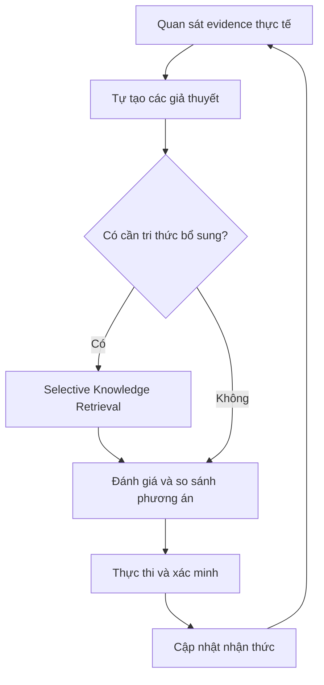
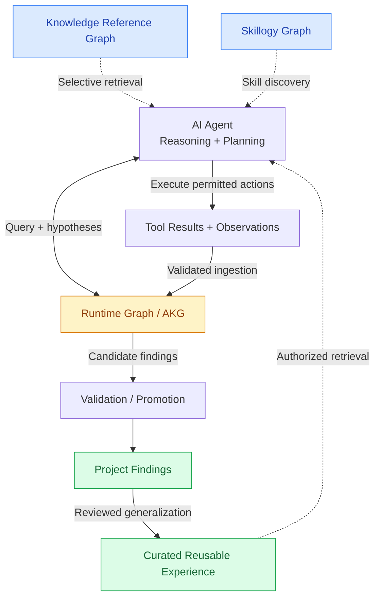

# Tối ưu kiến trúc Graph cho Raptix

- **Ngày:** 2026-11-02.
- **Trạng thái:** Đề xuất để thảo luận; **chưa phải ADR được chấp thuận, chưa có code nào được đổi**. Tài liệu này chỉ ghi lại mục tiêu + audit hiện trạng + kế hoạch triển khai dự kiến — người dùng sẽ review trước khi bất kỳ bước implementation nào bắt đầu.
- **Phạm vi:** Mọi graph (UI visualization và graph database) trong hệ thống: Asset Graph, Fact Graph, Workflow Builder, Chat Attack Chain, Neo4j AKG, Skillogy graph, `data/knowledge` corpus, pipeline MITRE ATT&CK STIX.
- **Nền đánh giá:** Đọc source trực tiếp (không chạy stack/benchmark) qua 7 lượt khảo sát: frontend graph UIs; backend/Neo4j data sources; nội dung + wiring của `data/knowledge`; cách agent Python thực sự đọc/viết AKG lúc runtime; cơ chế học xuyên-engagement; **quan hệ thật giữa `project`/`engagement`/`operation` trong Postgres + Python runtime**; **cấu trúc chi tiết `data/knowledge` + pipeline ATT&CK→Skillogy + nội dung thật của `benchmarks/`**.
- **Mức kiểm chứng:** Đọc source + test definitions; **chưa chạy live, chưa benchmark**. Mọi nhận định `[Hiện trạng]` ở lượt khảo sát sau đều kèm file/dòng cụ thể, không suy diễn từ tên biến/thư mục.

## Cách đọc tài liệu

Mỗi phát biểu được đánh dấu:
- **[Hiện trạng]** — đã xác minh trong source, kèm file/dòng khi có thể.
- **[Đề xuất]** — hướng xử lý được khuyến nghị, chưa phải quyết định đã duyệt.
- **[Cần chốt]** — lựa chọn còn ảnh hưởng đáng kể tới phạm vi, cần quyết định của người dùng trước khi code.

---

## 1. Mục tiêu

Chuẩn hóa cách hệ thống AI Red Team lưu trữ, truy vấn và sử dụng graph, nhằm:

- Giảm dữ liệu/node/edge trùng lặp không cần thiết.
- Giảm số nguồn dữ liệu có thẩm quyền chồng chéo hoặc mâu thuẫn.
- Cải thiện tốc độ/độ chính xác retrieval, giảm token/context overhead và latency khi agent truy vấn.
- Giảm retrieval không liên quan hoặc không mang lại giá trị.
- **Tăng khả năng tự suy luận của agent, không biến agent thành hệ thống chỉ tìm kiếm và lặp lại attack chain có sẵn.**
- Tăng khả năng resume/recover operation; tăng chất lượng findings/tri thức lưu dài hạn; đảm bảo dữ liệu tái tạo/kiểm chứng/bảo trì được.

**Nguyên tắc suy luận mục tiêu** (graph phải phục vụ suy luận, không chỉ là chỗ lưu dữ liệu):

- Evidence-first reasoning — agent ưu tiên trạng thái thực tế + evidence quan sát được để hình thành giả thuyết.
- Selective / on-demand retrieval — chỉ truy vấn phần liên quan, không đưa toàn bộ graph vào context.
- Knowledge as reference, not instruction — tri thức là tham khảo, không phải quy trình bắt buộc.
- Independent hypothesis generation — agent có thể đề xuất hướng chưa có trong Knowledge Graph.
- Adaptive planning — cập nhật kế hoạch liên tục theo evidence mới.
- Verification before learning — không tự động biến giả thuyết chưa kiểm chứng thành tri thức lâu dài.
- Controlled execution — mọi hành động tuân thủ RoE/safety policy.

### Graph-aware Reasoning Policy [bổ sung sau review]

Có retrieval tool **không đồng nghĩa** agent biết dùng tri thức thông minh. Ví dụ: agent phát hiện 1 web app có dấu hiệu cấu hình sai — nếu lập tức query Knowledge Graph, tìm được 1 attack pattern rồi mặc định làm theo, agent vẫn đang bị knowledge định hướng quá mức. Cần 1 policy rõ ràng, không chỉ là "có tool":

- **Khi nào query** — Knowledge Graph có thể dùng trước hoặc sau khi hình thành giả thuyết, tùy tình huống; việc truy xuất 1 attack pattern **không được mặc nhiên quyết định** hành động tiếp theo.
- **Mức độ tin tưởng kết quả** — kết quả retrieval mang theo confidence, không phải đúng tuyệt đối.
- **So sánh nhiều giả thuyết** — khi có >1 hướng khả thi, so sánh theo evidence/prerequisite/chi phí/rủi ro, không chỉ chọn hướng khớp Knowledge Graph nhất.
- **Evidence mâu thuẫn** — có quy tắc ưu tiên evidence thực tế hơn tri thức tham khảo khi 2 bên xung đột.
- **Suy luận không cần query** — agent phải tự suy luận được từ evidence/kết quả tool khi Knowledge Graph không có gì liên quan hoặc chưa cần query ở bước đó.
- **Phân loại nguồn thông tin** — phân biệt rõ: tri thức thực tế (Knowledge Reference Graph), hướng dẫn kỹ thuật, giả định (hypothesis chưa verify), và suy luận của LLM. **Kết quả retrieval không được xem là mệnh lệnh thực thi.**

Cơ chế suy luận mục tiêu (thay cho vòng lặp tuyến tính đơn giản):

**Tiêu chí đánh giá "đã tối ưu"** (không chỉ là "ít graph/database hơn"): tốc độ + độ chính xác retrieval; token/latency overhead khi agent query; khả năng lập kế hoạch/tự suy luận từ evidence; khả năng thích nghi tình huống mới; khả năng resume/recover operation; chất lượng findings dài hạn; khả năng tái tạo/kiểm chứng dữ liệu.

**[Cập nhật sau review] Về việc dùng `benchmarks/` để đánh giá:** đã kiểm tra trực tiếp — `benchmarks/` có các integration chuẩn hóa thật (CVE-Bench port ở `suites/cve_bench/`, providers `xbow`/`exploitbench`/`mhbench`/`cybench`/`cybergym`, chạy qua 1 `benchmarks.runner` CLI chung), nhưng toàn bộ đo **năng lực khai thác/tỷ lệ solve**, không đo **chất lượng reasoning hay hiệu quả graph retrieval**. Đây là 2 trục khác nhau — không dùng được trực tiếp làm acceptance criteria cho tài liệu này. Tiêu chí kiểm tra thực tế cho phạm vi graph nằm ở Mục 5 (functional/integration tests), không phải benchmark exploitation.

---

## 2. Kiến trúc mục tiêu — 4 graph độc lập, 3 nhóm theo vòng đời dữ liệu

### Nhóm 1 — Static / Reference

**(1) Knowledge Reference Graph**
Tri thức bảo mật từ MITRE ATT&CK, CAPEC, CWE, CVE, CISA KEV, OWASP, MITRE ATLAS — thực thể, kỹ thuật, lỗ hổng, điều kiện tiên quyết và quan hệ giữa chúng. Có nguồn gốc, phiên bản, cập nhật qua pipeline ingestion chính thức. Agent chỉ đọc, không tự sửa tri thức chuẩn giữa lúc pentest. Vai trò là nguồn tham khảo hỗ trợ suy luận, **không phải** tập attack chain cố định để agent làm theo.

**(2) Skillogy Graph**
Skill/capability agent có thể dùng, quan hệ phụ thuộc, điều kiện thực thi, input/output, tool liên quan. Độc lập với Knowledge Reference Graph (không gộp); có thể liên kết qua identifier chung, không copy toàn bộ dữ liệu.

### Nhóm 2 — Runtime

**(3) Runtime / Operational Graph — project-scoped working graph [cập nhật sau review, xem Mục 3.6]**
Bộ nhớ làm việc của agent, **phạm vi theo project** (không phải theo operation — đã xác minh không có entity Operation riêng trong Postgres, và mọi conversation cùng project đã chia sẻ chung 1 AKG scope hôm nay, Mục 3.6): asset, host, IP, port, service, vulnerability, credential reference, network relationship, attack path, observation, hypothesis, kết quả thực thi. Phải phân biệt dữ liệu quan sát được / giả thuyết chưa xác minh / kết quả đã xác minh. Mỗi item vẫn **truy vết được theo conversation/execution gốc** (provenance), nhưng truy vấn/liên kết diễn ra ở phạm vi project — đúng mục tiêu liên kết findings xuyên conversation cho post-exploitation/pivoting. Khôi phục được sau restart (đã đúng hôm nay, lưu Docker volume). Kết quả có giá trị lâu dài có thể promote sang Persistent Graph sau validation.

**Observation Ingestion Layer [bổ sung sau review — xem Vấn đề 2 ở Mục 4]** — Runtime Graph không nên chỉ cập nhật khi agent nhớ gọi `kg_record`/`kg_ingest`. Cần 1 layer nhận dữ liệu có cấu trúc từ các tool phù hợp, chuẩn hóa thành observation, gắn provenance, và cập nhật graph theo chính sách rõ ràng — không phải đưa mọi dòng output vào graph, chỉ dữ liệu xác định được nguồn/quan hệ/mức tin cậy. Agent vẫn chủ động ghi hypothesis/context khi cần. Mục tiêu: Runtime Graph phản ánh trạng thái thực tế của operation, không phụ thuộc vào việc LLM có nhớ gọi tool hay không.

### Nhóm 3 — Persistent

**(4) Persistent Knowledge / Experience Graph — 2 phạm vi dữ liệu, ranh giới truy cập khác nhau [cập nhật sau review]**

Persistent Graph **không đồng nghĩa** với graph chia sẻ tri thức giữa mọi engagement. Tách rõ 2 phạm vi — có thể cùng nằm trong 1 miền logic, nhưng ranh giới truy cập khác nhau:

- **(4A) Project-scoped Persistent Findings — không phải thành phần chưa tồn tại, mà là hoàn thiện cái đã có [cập nhật sau review]** — finding, evidence, attack path lâu dài **trong phạm vi project được phép truy cập**. Phục vụ báo cáo, tái kiểm thử, hoặc operation tiếp theo được cấp quyền **trong cùng project**. Đây **không phải** cross-project learning. **[Hiện trạng]** Các thành phần nền của (4A) **đã tồn tại**: `ProjectFact`/`ProjectFactEdge` đã lưu dữ liệu lâu dài trong Postgres (CRUD, confidence, nhiều loại quan hệ — Mục 3.1-3.2); Chat Attack Chain đã có action "Promote" ghi vào Fact Graph; AKG cũng đã lưu dữ liệu bền vững trong Neo4j (named volume); mọi conversation cùng project đã chia sẻ chung 1 `$engagement` = `Project.workspaceSlug` (Mục 3.6). **Việc còn thiếu không phải "xây Persistent Graph mới"**, mà là: (i) validation/provenance có kiểm soát cho dữ liệu promote vào Fact Graph (trạng thái `proposed`/`observed`/`verified`/`rejected`/`stale`, Mục 4), (ii) liên kết observation (AKG) ↔ finding (Fact Graph) — hiện tại 0% đồng bộ (Mục 3.3), và (iii) khả năng truy vấn attack chain xuyên AKG+Fact Graph theo project.
- **(4B) Curated Reusable Experience** — kinh nghiệm áp dụng rộng hơn, **chỉ sau khi** tổng quát hóa, loại bỏ thông tin nhạy cảm, và phê duyệt theo chính sách. Không tự động chia sẻ dữ liệu giữa các engagement.

**Lưu ý quan trọng:** ẩn danh dữ liệu **không tự động** bảo đảm an toàn — 1 attack path hoặc tổ hợp đặc điểm kỹ thuật dù đã bỏ IP vẫn có thể nhận diện hệ thống cụ thể. Cơ chế (4B) phải có security review, kiểm soát nguồn gốc và quyền sử dụng riêng — không chỉ là 1 bước "de-identify" đơn giản.

**[Đề xuất] Thứ tự triển khai:** ưu tiên (4A) trước, giữ nguyên cách ly engagement hiện có. (4B) chỉ bổ sung sau khi có thiết kế bảo mật và quyết định rõ ràng riêng (xem invariant ở Mục 3.5 và ADR+threat-model riêng ở Mục 4).

### Nguyên tắc dữ liệu/lưu trữ chung

4 graph độc lập về chức năng, **không bắt buộc chung 1 Neo4j instance/database** — số lượng database vật lý theo nhu cầu vận hành/hiệu năng/cách ly, không chốt trước. PostgreSQL vẫn giữ vai trò transactional store cho user/project/operation metadata/asset catalog/reporting. Mỗi loại dữ liệu cần 1 source of truth rõ ràng; bản sao/projection phục vụ UI phải có cơ chế đồng bộ + lineage. Các graph liên kết qua identifier + API/query layer, không gộp schema hoặc copy toàn bộ dataset. Tránh trùng lặp Knowledge Reference ↔ Skillogy, hoặc Runtime ↔ Persistent.

### Cơ chế kết nối 4 graph thành 1 hệ thống reasoning thống nhất [bổ sung sau review]

4 graph là 4 kho dữ liệu độc lập — chưa đủ để thành "hệ thống hỗ trợ suy luận tự chủ" nếu thiếu cơ chế nối chúng lại. Bổ sung 3 cơ chế:

1. **Graph-aware Reasoning Policy** — agent dùng graph nào, khi nào, truy vấn ra sao, đánh giá kết quả thế nào, tránh phụ thuộc vào tri thức có sẵn (chi tiết ở trên).
2. **Observation Ingestion Layer** — Runtime Graph cập nhật chính xác từ hoạt động thực tế, không phụ thuộc hoàn toàn vào việc LLM chủ động gọi `kg_record` (chi tiết ở trên, và Vấn đề 2 ở Mục 4).
3. **Validated Knowledge Promotion** — chuyển kết quả có giá trị từ Runtime sang Persistent (4A/4B), kiểm soát xác minh/quyền sở hữu/vòng đời/phạm vi tái sử dụng (chi tiết ở Mục 4).

Nét đứt (`K`/`S`/`E` → `A`) = retrieval theo nhu cầu, **không bắt buộc ở mọi lượt**, đúng nguyên tắc selective/on-demand. `P → E` chỉ xảy ra qua Validated Knowledge Promotion có review, không tự động — và `P` (Project Findings) ở đây là (4A), `E` (Curated Reusable Experience) là (4B).

---

## 3. Hiện trạng đã xác minh (audit)

> Đây là **source-code audit sơ bộ** — đọc source, chưa chạy live stack, chưa benchmark. Các kết luận dưới dựa trên những gì tìm được trong code, không phải hành vi runtime đã xác nhận. Baseline + acceptance criteria để xác nhận hành vi thật ở Mục 5.

### 3.1. Toàn bộ graph hiện có **[Hiện trạng]**

4 graph hiển thị UI (đều Cytoscape.js) + 2 graph database chỉ có ở backend (chung 1 Neo4j instance) + 1 bộ dữ liệu đã chuẩn hóa sẵn, chưa được ingest + 1 pipeline chính thức nhưng dùng hẹp:

| Graph | Nơi | Node | Edge | Backend thật |
|---|---|---|---|---|
| **Asset Graph** | Asset Management | domain/ip/port/service/vulnerability/asset | **tự tính ở client**, không phải kết nối thật | 100% Postgres (`/api/assets`, `/api/vulnerabilities`) |
| **Fact Graph ("Attack path")** | Operation Center | fact theo 8 category (target/auth/infra/business/exploit/poc/vulnerability/chain) + confidence | `leads_to`/`enables`/`depends_on`/`contains`/`discovered_on` + `links_vuln` | 100% Postgres (`ProjectFact`/`ProjectFactEdge`, Prisma) — **không liên quan Neo4j** |
| **Workflow Builder** | Workflows | bước workflow (start/tool/agent/condition/hitl/end) | luồng điều khiển tự vẽ | *(canvas thiết kế, không phải graph quan hệ)* |
| **Chat Attack Chain** | trong từng cuộc chat | target/action/vulnerability (3 loại) | `discovers`/`targets`/`enables`/`leads_to` | 1 lần gọi LLM, cache **trong RAM process**, mất khi `api` restart |
| **Neo4j "AKG"** | chỉ backend, không UI | Host/Network/Domain/Service/URL/CloudResource/Container, User/Group/Credential/Secret/Session, Vulnerability/CVE/Misconfiguration/Weakness, code/attack-reasoning/defense/BloodHound/Slither/surface-inventory nodes | quan hệ thật trong Neo4j | bộ nhớ làm việc thật của agent, scope = project (xem Mục 3.6) |
| **Skillogy graph** | chỉ backend, không UI | `:Tactic`, `:Technique`, `:Skill`, `:Tag`, `:Phase`, `:MoC` — **chỉ 2 loại STIX object được parse: tactic + technique** | `HAS_TECHNIQUE`/`HAS_SUBTECHNIQUE`/`IMPLEMENTS` trong Neo4j (**chung instance** với AKG — Community edition chỉ cho 1 DB/server) | compile CI-time từ `skills.cypher` (14.991 dòng); **không có node mitigation/group/software/CVE nào** |
| **`data/knowledge` corpus** | thư mục local, do người dùng tự thu thập/chuẩn hóa | 5.850 file YAML (ATLAS/ATT&CK/CAPEC/CISA KEV/CWE/OWASP), đã có `id`/`source`/`type`/`references`/`metadata` nhất quán | `relationships:` — một số cross-taxonomy thật (CAPEC→CWE), một số intra-taxonomy, 1 loại đã đánh dấu `external_unresolved` (CISA KEV→CVE) | **chưa có code ingest** — là input thô cho Knowledge Reference Graph, không phải vấn đề chất lượng dữ liệu (xem Mục 3.6/Mục 4) |
| **ATT&CK STIX bootstrap** | `make bootstrap-skill-graph` | MITRE ATT&CK Enterprise **v19.1**, pinned | — | hash-verified, tái tạo mọi máy, nhưng chỉ nuôi Skillogy (tactic+technique), **không phải nguồn tri thức bảo mật tổng quát** |

Quét toàn repo (`cytoscape`/`d3-force`/`vis-network`/`dagre`/`sigma.js`/`G6`) xác nhận không còn graph nào khác.

### 3.2. Schema / nguồn / quyền đọc-viết / lifecycle từng graph **[Hiện trạng]**

**AKG (Neo4j)**
- Viết: chỉ qua tool call rõ ràng của agent — `kg_record` (JSON tay) / `kg_ingest` (output scanner qua parser). **Không có gì tự ghi sau mỗi tool call.** Cypher `MERGE` qua `UNWIND`; field provenance (engagement, firstseen, lastupdated, created_by, source_episode_id) server tự gán, agent không override được.
- Scope: mọi Cypher runtime bị ép có `$engagement` (lấy từ state, LLM không set được — chặn prompt-injection vượt scope). **`$engagement` = `Project.workspaceSlug`, tức cùng phạm vi với `project` trong Postgres — xem Mục 3.6 để biết chi tiết đã xác minh.**
- **Điểm cần xác minh thêm, chưa phải gap bảo mật đã xác nhận:** `kg_record`/`kg_ingest` không nằm trong `middleware/roe.py`'s `GATED_TOOL_NAMES` (khác với `bash`/`http_request`/`browser_action`/`web_fetch`). Đây là source-code audit — chưa đủ để kết luận chắc chắn có thể vượt toàn bộ RoE, cần kiểm tra thêm các lớp kiểm soát khác và phân biệt rõ "quyền ghi knowledge" với "quyền thực hiện hành động trên mục tiêu" (2 thứ khác nhau). Nếu sau khi kiểm tra xác nhận có khoảng trống thật, xử lý riêng (ADR + threat-model) **trước khi** mở rộng graph functionality, không gộp vào kế hoạch graph này.
- Đọc: **không phải query theo yêu cầu** — `KGMiddleware` build lại 1 summary markdown nhỏ (đếm node/edge, top 5 vuln, ≤3 entrypoint chưa khám phá, ≤10 crown jewel, claims chưa verify tùy chọn — ~15-25 dòng) mỗi khi revision đổi, rồi **nhồi vào mọi system prompt mỗi turn**, bất kể có liên quan hay không. Không có tool query tùy ý cho LLM — muốn đào sâu phải tự `bash('cypher-shell ...')`.
- Lifecycle: lưu trong Docker **named volume** (`neo4j_data`) — **không mất khi tắt Docker/restart container**, chỉ mất khi xóa volume rõ ràng (`docker compose down -v` hoặc `docker volume rm`). Phân vùng theo engagement chỉ là filter logic (property), không tách DB vật lý. **Không có dọn dẹp tự động** giữa các engagement — dữ liệu tích lũy vô hạn trừ khi operator chạy `raptix-cli kg reset --engagement ... --yes` thủ công.

**Skillogy graph** — nguồn thật là `skills.cypher` (biên dịch CI-time từ SKILL.md + seed YAML + STIX pinned), read-only lúc runtime, RPC hẹp (`find_skill`/`load_skill`/`traverse`), không drift được.

**Asset Graph (UI)** — không có store riêng, đọc Postgres; **đồng bộ 1 chiều từ AKG** (Host/Service) vào Postgres `Asset` mỗi lần fetch list (`kg-assets-sync.ts`), theo ADR-0094 (Postgres = catalog chính thức, Neo4j = observed relations).

**Fact Graph (UI)** — Postgres thuần, CRUD đầy đủ, confidence lifecycle. **Xác nhận không có liên kết nào với AKG, 2 chiều.**

**Chat Attack Chain (UI)** — ephemeral, RAM process only — **đây rất có thể là nguồn gốc của nhầm lẫn "Neo4j mất khi tắt Docker"**, vì chính feature cũng tên "attack chain" nhưng mất khi `api` restart, còn AKG (Neo4j) thì không.

**`data/knowledge`** **[cập nhật sau review — đã khảo sát sâu, không còn coi là "chưa đáng tin"]**
- Đây **không phải** bản copy ngẫu nhiên. `MANIFEST.json` ghi rõ: nguồn (`source_project: D:/.Alice/security-knowledge-ingestion` — pipeline do người dùng tự xây), tiêu chí chọn lọc (`revoked=0, deprecated=0`), ngày copy, và đếm chính xác theo từng `source/type`. Đây là **provenance ở mức manifest**, hợp lệ.
- `index.json` (3,47MB) chỉ là **index phẳng để tìm kiếm** (`id/source/type/name/description/status/path`) — không phải bản thân graph. Cấu trúc quan hệ nằm trong field `relationships:` của từng file YAML.
- Mỗi nguồn đều có tín hiệu version/provenance riêng: ATT&CK có `attack_version: '19.2'`; CWE/CAPEC có `catalog_version` + `catalog_date` + `content_history` đầy đủ; OWASP có git commit SHA + content hash; ATLAS có `collection_version`/`format_version`. Riêng CISA KEV yếu nhất (chỉ có `raw_artifact` path, không có catalog version).
- `relationships:` cross-taxonomy **có thật và giải quyết được** ở CAPEC→CWE (`related_weakness`). CISA KEV→CVE/NVD có khai báo nhưng tự đánh dấu `external_unresolved` (namespace `nvd:` chưa được thu thập). CWE→CVE chỉ là text tự do trong `observed_examples`, không phải edge. ATT&CK và ATLAS chỉ có quan hệ intra-taxonomy trong mẫu đã đọc.
- Vấn đề thật duy nhất là **tích hợp**, không phải chất lượng: chưa có code nào đọc thư mục này, và nó bị gitignore nên không có trên máy khác/CI. Đây là việc cần giải quyết ở Mục 4/5 (pipeline ingestion + quản lý dữ liệu), không phải lý do loại bỏ dữ liệu.

**ATT&CK STIX bootstrap** **[cập nhật sau review]** — `stix_bootstrap.py` pin đúng 1 bundle STIX Enterprise **v19.1** (JSON thô, UUID-keyed). `mitre_stix.py` chỉ parse 2 loại STIX object: `x-mitre-tactic` và `attack-pattern` (technique) — **không** đọc `course-of-action` (mitigation), `intrusion-set` (group), `malware`/`tool`, `campaign`. `skills.cypher` biên dịch ra xác nhận: không có label `:CourseOfAction`/`:Group`/`:Software` nào. Mục đích duy nhất là gắn tag kỹ thuật cho skill (`IMPLEMENTS` edge Skill→Technique) để chọn skill — **không có đường nào agent query ATT&CK như tri thức bảo mật tổng quát** (vd. "cái gì mitigate technique X" không trả lời được, vì graph không có dữ liệu mitigation). So với `data/knowledge/attack/` (v19.2, đã chuẩn hóa, có đủ `mitigation_links`/`detection_strategies`/`procedure_examples`) thì pipeline Skillogy **hẹp hơn nhiều**, không phải nền tốt để "mở rộng" cho Knowledge Reference Graph — xem Mục 4.

### 3.3. Overlap cụ thể giữa AKG, Asset Graph, Fact Graph, Chat Attack Chain **[Hiện trạng]**

- **AKG ↔ Asset Graph:** overlap có chủ đích, đã tài liệu hóa (ADR-0094), đồng bộ tự động 1 chiều. **[Cập nhật sau review] Chưa chắc "không phải vấn đề"** — đồng bộ diễn ra ngay tại thời điểm frontend fetch asset list (`kg-assets-sync.ts`), nghĩa là có thể ảnh hưởng độ mới dữ liệu (đọc trong lúc đang sync), hiệu năng (sync chạy đồng bộ với mỗi lần load list), và tính nhất quán (2 request đồng thời có thể thấy state khác nhau). Cần đánh giá lại ở bước implementation/functional test (Mục 5 — không còn dùng benchmark exploitation), không coi là đã giải quyết chỉ vì có ADR.
- **AKG ↔ Fact Graph: overlap thật, chưa tài liệu hóa, xác nhận 0% đồng bộ.** Cả 2 có thể độc lập ghi "host X có vulnerability Y" mà không liên kết — đây là điểm rõ nhất vi phạm tiêu chí "giảm nguồn thẩm quyền chồng chéo".
- **AKG ↔ Chat Attack Chain:** không liên quan gì — Chat Attack Chain không bao giờ chạm Neo4j.
- **Fact Graph ↔ Chat Attack Chain:** đã có cầu nối chủ động, 1 chiều (`promoteConversationAttackChain` trong `features/projects/tables.ts`, action "Promote"), chỉ trong cùng project — không phải vấn đề.

### 3.4. Agent thực sự dùng từng nguồn thế nào hôm nay **[Hiện trạng]**

- **AKG:** viết = chỉ tool call tay; đọc = nhồi summary cố định mỗi turn — **ngược hoàn toàn với nguyên tắc "selective/on-demand retrieval"** trong Mục 1. Không có tool query theo yêu cầu, chỉ có đường thoát `cypher-shell`.
- **Skillogy:** RPC hẹp cho chọn skill — đã khá khớp với vai trò Skillogy Graph mục tiêu.
- **Taxonomy bảo mật (ATT&CK/CWE/CAPEC/CISA KEV/OWASP/ATLAS): chưa được dùng như nguồn Knowledge Reference retrieval tổng quát hôm nay** — sửa lại cho chính xác hơn, vì MITRE ATT&CK **đã** được dùng gián tiếp (để xây Skillogy's tactic/technique tagging, Mục 3.2), chỉ là không phải như tri thức bảo mật tổng quát cho reasoning. Scan/index của Knowledge Management trả 501; `data/knowledge` chưa được ingest; ATT&CK bootstrap chỉ nuôi Skillogy (tactic+technique cho chọn skill — xem Mục 3.2). **Knowledge Reference Graph không có pipeline runtime nào để kế thừa, nhưng đã có sẵn 1 bộ dữ liệu đã chuẩn hóa (`data/knowledge`) làm input — khác với "phải xây từ đầu kể cả dữ liệu".**

### 3.5. Source of truth / đồng bộ **[Hiện trạng]**

- Asset: sạch — 1 đường đồng bộ tự động, tài liệu hóa (ADR-0094).
- **Fact/finding: vấn đề thẩm quyền chồng chéo rõ nhất** — AKG và `ProjectFact` là 2 nguồn không đồng bộ, chưa từng quyết định ai là chính.
- Skill: sạch — `skills.cypher` từ source control là nguồn duy nhất.
- Taxonomy bảo mật: chưa có nguồn chính thức nào cho mục đích tổng quát — đây là đất mới, không phải việc sửa đồng bộ.
- **Cross-*project* experience (không phải "cross-engagement" — xem Mục 3.6 để biết tại sao đổi từ): cố ý không tồn tại, vì lý do bảo mật, không phải thiếu sót.** `KGStore` chặn cứng mọi Cypher thiếu `$engagement`. Doc thiết kế `docs/proposals/redamon-feature-integration.md` ghi rõ invariant cần giữ: *"keep all KG writes strictly engagement-scoped (no cross-engagement learning)"*. Threat model ghi nhận 1 sự cố thật đã đóng: *"Cross-engagement data leak via web dashboard... Hostile customer reads competitor's findings."* Sự cố này mô tả rò rỉ **giữa 2 project/khách hàng khác nhau** ("hostile customer", "competitor's findings") — đúng ranh giới cần giữ. **→ (4B) Curated Reusable Experience vẫn xung đột trực tiếp với invariant này** nếu hiểu đúng "cross-engagement" = "cross-project". **(4A) Project-scoped Persistent Findings không xung đột** — xem Mục 3.6.

### 3.6. Project / Engagement / Operation — xác minh trực tiếp từ code **[Hiện trạng]**

Bản trước của tài liệu dùng "engagement" như 1 phạm vi có thể hẹp hơn "project", ngụ ý các operation/conversation trong cùng 1 project có thể bị cách ly với nhau. Đã kiểm tra lại trực tiếp — **điều này sai**:

- **Không có bảng `Operation`/`Engagement`/`Run` nào trong Postgres.** `apps/api/prisma/schema.prisma` chỉ có `Project` → nhiều `Conversation` (`projectId`). "Operation" trong tài liệu trước chỉ là từ mô tả, không phải entity có thật.
- **`engagement`/`kg_engagement` = `Project.workspaceSlug`, 1:1 với `Project`.** Trace đầy đủ: `apps/api/src/adapters/sandbox/routing.ts` gán `engagement_name`/`kg_engagement` = `workspaceSlug` của project (sinh 1 lần lúc tạo project, `prisma/schema.prisma`: "Generated once at creation from the project id … never user-editable") → `packages/raptix/raptix/orchestration/mission/engagement.py` (`EngagementContextMiddleware`) copy giá trị này vào state → `middleware/kg.py` dùng làm `$engagement`. **Kết luận: `engagement` chính là `project`, không phải phạm vi hẹp hơn.**
- **Không có "operation" nào tách biệt `project` để AKG phân vùng theo.** Mỗi conversation mới dưới cùng 1 project lấy lại đúng `workspaceSlug` của project đó (`agent-loop.routes.ts` tra project theo `projectId` mỗi request) — không sinh engagement mới theo conversation/thread.
- **Hệ quả quan trọng: mọi conversation trong cùng 1 project đã chia sẻ chung 1 AKG scope ngay từ hôm nay**, không cần code mới. `store.py` chỉ kiểm tra có `$engagement` trong Cypher hay không (`execute_read`/`execute_write`), không có filter theo conversation/thread nào thêm. Đây là tính chất sẵn có của wiring hiện tại, không phải tính năng được quảng cáo/test rõ ràng, nhưng đã hoạt động đúng như yêu cầu ở Mục "Làm rõ Project, Engagement và Operation": **findings/observations/assets/attack relationships trong cùng project đã liên kết được xuyên nhiều operation (conversation), phục vụ post-exploitation/pivoting/lateral movement.**
- **Ranh giới isolation thật nằm giữa project khác nhau**, đúng như sự cố threat-model mô tả (2 khách hàng khác nhau) — khớp với yêu cầu "isolation cần giữa project, không phải giữa operation cùng project".
- **Tự mâu thuẫn trong bản trước của tài liệu, đã sửa:** dòng về (4A) nói đúng ("operation tiếp theo **trong cùng phạm vi**... không phải cross-engagement learning"), nhưng phần invariant ở trên lại dùng "cross-engagement" theo nghĩa rộng hơn. Đã thống nhất lại: **"engagement" = "project"** trong toàn tài liệu; ranh giới cần bảo vệ là **cross-project**, không phải cross-operation-trong-project.

**Không có security boundary nào bị phá vỡ bởi việc này** — đây là làm rõ thuật ngữ + xác nhận 1 khả năng đã tồn tại, không phải thiết kế mới.

---

## 4. Đối chiếu hiện trạng ↔ mục tiêu, các điểm cần chốt

### Bảng ownership đề xuất [bổ sung sau review]

Đây là **đề xuất về ownership** (ai là nguồn chính thức cho loại dữ liệu nào), **không phải** yêu cầu chuyển tất cả dữ liệu về Neo4j:

| Dữ liệu | Nguồn chính thức đề xuất |
|---|---|
| Technical observations, quan hệ host/service | Runtime Graph (AKG) |
| Asset catalog và metadata phục vụ quản lý | PostgreSQL |
| Project findings đã được chấp nhận | Fact/Persistent Layer (4A) |
| Reusable experience đã được phê duyệt | Curated Experience Layer (4B) |
| Attack Chain trong Chat | Visualization dẫn xuất — **không phải nguồn chính thức** |

### Vấn đề 1 — Graph-aware Reasoning Policy (ưu tiên cao nhất)

**[Cần chốt]** Mục 1 đã bổ sung yêu cầu cụ thể (khi nào query, confidence, so sánh giả thuyết, xử lý evidence mâu thuẫn, suy luận không cần query, phân loại nguồn thông tin). Trước khi implementation: xác nhận policy này áp dụng thế nào vào middleware thật (ví dụ `KGMiddleware`/system prompt hiện tại) thay vì chỉ là nguyên tắc trên giấy.

### Vấn đề 2 — Runtime Graph cần Observation Ingestion Layer, không chỉ thêm query tool

**[Cần chốt]** Theo audit (Mục 3.2), agent chỉ ghi AKG khi chủ động gọi `kg_record`/`kg_ingest` — không có gì tự động cập nhật sau mỗi tool call. Chỉ thêm query tool (bản trước của tài liệu) không đủ. Cần thiết kế **Observation Ingestion Layer** (Mục 2, Nhóm 2): nhận dữ liệu có cấu trúc từ tool phù hợp, chuẩn hóa, gắn provenance, cập nhật graph theo chính sách — chỉ ghi dữ liệu xác định được nguồn/quan hệ/độ tin cậy, không phải mọi dòng output. Agent vẫn chủ động ghi hypothesis khi cần.

### Vấn đề 3 — Persistent Graph: tách 2 phạm vi, không đồng nhất với cross-*project* learning

**[Cần chốt]** Mục 2 (Nhóm 3) đã tách thành (4A) Project-scoped Persistent Findings và (4B) Curated Reusable Experience. Sau khi xác minh Mục 3.6 (`engagement` = `project`): **(4A) không xung đột với invariant bảo mật nào** — nó chỉ giữ lại finding đã validate trong đúng phạm vi project, khả năng chia sẻ xuyên operation cùng project đã có sẵn ở tầng AKG. Chỉ **(4B)** mới thật sự là cross-*project* learning, và vẫn xung đột trực tiếp với invariant "no cross-engagement (= cross-project) learning" ở Mục 3.5 — chỉ làm sau khi có ADR + threat-model riêng, kèm lưu ý: **ẩn danh không tự động an toàn** (attack path/đặc điểm kỹ thuật vẫn có thể định danh hệ thống dù đã bỏ IP). **Ưu tiên giai đoạn đầu: hoàn thiện (4A) dựa trên thành phần đã có** (`ProjectFact`/`ProjectFactEdge`, action Promote, AKG) — không phải xây Persistent Graph từ đầu, xem chi tiết ở Mục 2.

### Vấn đề 4 — Data ownership giữa AKG, Asset Graph, Fact Graph, Chat Attack Chain

**[Cần chốt]**
- **AKG ↔ Asset Graph:** không coi là "đã giải quyết" chỉ vì có ADR-0094 — cần đánh giá lại độ mới dữ liệu/hiệu năng/nhất quán của việc sync ngay lúc fetch (xem Mục 3.3 đã cập nhật).
- **Fact Graph:** dữ liệu operator ghi nhận **chưa chắc đã verified**. Cần trạng thái rõ ràng: `proposed` / `observed` / `verified` / `rejected` / `stale` — thay vì coi mọi `ProjectFact` là verified finding.
- **Fact Graph ↔ AKG:** **không** chỉ tạo 1 sync job copy toàn bộ AKG sang Fact Graph. Cần cơ chế liên kết observation (AKG) với finding (Fact Graph) theo bảng ownership trên, cho phép chọn lọc, xác minh, và Promote có kiểm soát (Validated Knowledge Promotion, Mục 2) — không máy móc đồng bộ toàn bộ.

### Vấn đề 5 — Knowledge Reference Graph: đã chốt là 1 trong 4 graph chính thức, không còn là câu hỏi [cập nhật sau review]

**Đã quyết định, không phải [Cần chốt] nữa:** Knowledge Reference Graph là 1 trong 4 graph mục tiêu (Mục 2). Không còn thảo luận "có nên xây hay không". Threat Intelligence/Security Knowledge thuộc miền graph này; **không tạo thêm 1 Threat Intelligence Graph tách biệt ngoài 4 graph đã thống nhất.** Knowledge Management (trang/feature hiện có) là lớp quản lý nguồn/ingestion/indexing/truy vấn **phục vụ** Knowledge Reference Graph — không mặc định là 1 graph thứ 5.

**Nguồn dữ liệu — đã xác minh (Mục 3.1-3.2), không phải suy diễn:**
- `data/knowledge` là dữ liệu đã được chuẩn hóa sẵn, có provenance thật (manifest + per-source catalog version), **không cần coi là thiếu tin cậy**. Việc còn thiếu là tích hợp (ingest + quản lý vị trí lưu trữ), không phải chất lượng dữ liệu.
- Pipeline ATT&CK→Skillogy (`stix_bootstrap.py`/`mitre_stix.py`) chỉ trích 2 loại STIX object (tactic+technique) để gắn tag skill — **hẹp hơn nhiều** so với `data/knowledge/attack/` (đã có mitigation/detection/procedure, v19.2 so với v19.1 của bootstrap). Khuyến nghị kỹ thuật (chưa phải quyết định cuối): **dùng `data/knowledge` làm nguồn chính cho Knowledge Reference Graph's phần ATT&CK, không "mở rộng" pipeline Skillogy** — 2 định dạng (STIX JSON thô vs YAML đã chuẩn hóa) không tương thích trực tiếp nên dù chọn nguồn nào cũng cần code transform, nhưng `data/knowledge` đỡ việc resolve UUID STIX hơn.
- Cross-taxonomy relationship có thật (CAPEC→CWE) và có loại chưa resolve được (CISA KEV→CVE, thiếu namespace `nvd:`) — cần tính đến khi thiết kế schema, không giả định mọi quan hệ đều sẵn dùng.
- Vấn đề gitignore: cần 1 phương án quản lý dữ liệu hợp lý (ví dụ: giữ `data/knowledge` làm working copy ngoài git như hiện tại, nhưng thêm 1 manifest/hash nhỏ được commit để tái tạo được, hoặc 1 script fetch lại từ pipeline gốc của người dùng) — **không mặc định phải commit toàn bộ 5.850 file vào git**, và không tự ý xóa/yêu cầu tải lại dữ liệu hiện có khi chưa chứng minh được sự cần thiết.

### Phát hiện phụ (bảo mật, ngoài phạm vi graph) [đã điều chỉnh mức độ chắc chắn]

`kg_record`/`kg_ingest` không có tên trong `GATED_TOOL_NAMES` — đây là **phát hiện cần xác minh thêm**, không phải kết luận chắc chắn đã có lỗ hổng vượt RoE (xem ghi chú đã sửa ở Mục 3.2). Nếu xác nhận có khoảng trống thật sau khi kiểm tra các lớp kiểm soát khác, xử lý riêng trước (RoE enforcement là guard rail; CONTRIBUTING_AGENT.md yêu cầu ADR + threat-model riêng để đụng vào), không gộp vào kế hoạch graph.

---

## 5. Kế hoạch triển khai theo giai đoạn (chưa thực hiện)

> **Toàn bộ mục 5 là dự kiến, chưa code. Chỉ thực hiện sau khi người dùng duyệt từng bước.**

1. ~~Liệt kê đầy đủ graph/visualization/dataset~~ — **xong, source-code audit** (Mục 3.1).
2. ~~Kiểm tra schema, loại node/edge, nguồn, quyền đọc/viết, lifecycle~~ — **xong, source-code audit** (Mục 3.2).
3. ~~Xác định overlap AKG/Asset Graph/Fact Graph/Chat Attack Chain~~ — **xong, source-code audit** (Mục 3.3).
4. ~~Kiểm tra cách agent thực sự dùng AKG/Skillogy/knowledge~~ — **xong, source-code audit** (Mục 3.4).
5. ~~Xác định source of truth, quan hệ, cơ chế đồng bộ~~ — **xong, source-code audit** (Mục 3.5).

> **Lưu ý:** bước 1-5 là **source-code audit sơ bộ**, chưa phải xác nhận hành vi runtime. Trước khi coi bất kỳ kết luận nào ở Mục 3-4 là "đã xác nhận", cần baseline + acceptance criteria dưới đây.

### Functional / integration acceptance criteria [cập nhật sau review — không dùng benchmark exploitation]

> Đã loại bỏ việc dùng `benchmarks/` làm căn cứ đánh giá (xem Mục 1) — `benchmarks/` đo năng lực khai thác/tỷ lệ solve, không đo chất lượng graph/reasoning. Tiêu chí dưới là functional/integration test, kiểm tra refactor không phá chức năng/dữ liệu/security boundary, không phải benchmark năng lực.

| Hạng mục | Điều cần chứng minh |
|---|---|
| Observation | Ghi và truy vấn chính xác; không tạo bản ghi trùng lặp ngoài dự kiến |
| Knowledge retrieval | Agent lấy được relevant context khi cần, không phụ thuộc cứng vào attack path có sẵn |
| Liên kết xuyên operation | Findings liên kết được xuyên nhiều operation **trong cùng project** (Mục 3.6) |
| Project isolation | Được duy trì đúng — không rò rỉ giữa project khác nhau |
| Runtime Graph | Operation khôi phục được sau restart |
| Validated Promotion | Bảo toàn evidence + provenance; không tự động chia sẻ finding giữa project |
| Nhất quán dữ liệu | Không phát sinh sai lệch giữa các graph (đặc biệt AKG ↔ Fact Graph) |
| Hiệu năng | Chi phí truy vấn, latency, context overhead không tăng bất hợp lý so với trước |

6. **[Đề xuất, cần chốt]** Thiết kế kỹ thuật (Technical Design) cho kiến trúc 4-graph + 3 cơ chế kết nối — **chỉ yêu cầu bắt buộc phải giải quyết ở bước này, chưa viết implementation chi tiết**:

   **Graph schema và data model**
   - Node/edge types và relationships; định danh thực thể (identity resolution); provenance/confidence/timestamps/lifecycle; deduplication và idempotency.
   - Phân biệt rõ observation / hypothesis / finding / evidence.
   - Phạm vi dữ liệu theo **project** (không phải "operation" — đã xác minh không có entity Operation riêng, Mục 3.6).
   - Quy tắc liên kết + cập nhật dữ liệu giữa các graph (đặc biệt AKG ↔ Fact Graph, theo bảng ownership ở Mục 4).

   **Observation Ingestion Layer**
   - Cách nhận dữ liệu từ tool phù hợp; chuẩn hóa output thành structured observation.
   - Validation + kiểm soát chất lượng trước khi ghi; xử lý dữ liệu trùng lặp/mâu thuẫn/không đáng tin.
   - Không tự động lưu toàn bộ raw output không cần thiết.
   - Không phụ thuộc hoàn toàn vào việc LLM chủ động gọi `kg_record`/`kg_ingest`.

   **Graph Query Interface [bổ sung sau review]**
   - Truy vấn theo nhu cầu, không force-inject toàn bộ graph vào context (đang vi phạm ở AKG hôm nay, Mục 3.2/3.4).
   - Scope isolation + access control theo project.
   - Query validation + giới hạn tài nguyên: số lượng node/edge, traversal depth, dung lượng kết quả.
   - Trả về relevant subgraph kèm provenance/confidence khi phù hợp.
   - Tránh trao quyền thực thi Cypher tùy ý không kiểm soát cho LLM (hôm nay agent đang dùng `bash('cypher-shell ...')` làm đường thoát — cần đánh giá lại khi có Query Interface thật).

   **Validated Knowledge Promotion**
   - Quy tắc chuyển dữ liệu từ Runtime Graph sang (4A) Project-scoped Persistent Findings.
   - Liên kết observation với finding thay vì sao chép toàn bộ.
   - Trạng thái `proposed`/`observed`/`verified`/`rejected`/`stale` cho `ProjectFact` (Mục 4).
   - Giữ lại nguồn evidence + lịch sử xác minh.
   - Không tự động chia sẻ findings giữa project. (4B) Curated Reusable Experience vẫn là phạm vi mở rộng sau, cần ADR + threat-model riêng.

   **Graph-aware Reasoning Policy** — giữ nguyên yêu cầu ở Mục 1 (evidence-first, independent hypothesis generation, retrieval không bắt buộc mọi bước, Knowledge Reference Graph không là instruction/attack chain bắt buộc, hỗ trợ so sánh giả thuyết + evidence mâu thuẫn + adaptive planning, hành động thực thi tuân thủ RoE/safety).

   **Nguồn dữ liệu Knowledge Reference Graph:** đã xác minh ở Mục 4, Vấn đề 5 — ưu tiên tái dùng `data/knowledge` (đã chuẩn hóa), không viết lại pipeline Skillogy; xử lý rõ 2 loại cross-taxonomy relationship (resolved: CAPEC→CWE; chưa resolved: CISA KEV→CVE).

   **Project/Engagement/Operation:** Runtime Graph và (4A) phải dùng đúng model đã xác minh ở Mục 3.6 — phạm vi dữ liệu + quyền truy cập theo **project**, không theo "operation" (không tồn tại như entity riêng).

7. **[Đề xuất]** Đánh giá tái dùng component có sẵn trước khi build mới: pattern render Cytoscape+ELK của Fact Graph, wrapper Cypher của `KGStore`, cấu trúc đã chuẩn hóa của `data/knowledge` (ưu tiên hơn viết lại STIX parser).
8. **[Đề xuất]** Triển khai từng bước nhỏ, không mất dữ liệu, không phá chức năng đang chạy — thứ tự ưu tiên theo rủi ro/giá trị: xác minh/vá RoE-gating (nếu xác nhận cần) → Graph Query Interface + Observation Ingestion Layer → Graph-aware Reasoning Policy → Knowledge Reference Graph (dựa trên `data/knowledge`) → hoàn thiện (4A) Project-scoped Persistent Findings (validation/provenance + liên kết AKG↔Fact, dựa trên thành phần đã có) → chỉ sau đó mới xét (4B).

---

## 6. Việc KHÔNG làm trong tài liệu này

Tài liệu này chỉ ghi nhận mục tiêu + audit + kế hoạch dự kiến. **Chưa có file code nào bị sửa, chưa migration database, chưa triển khai tính năng mới.** Bước 6-8 ở Mục 5 chỉ bắt đầu sau khi người dùng đọc và duyệt rõ từng điểm "[Cần chốt]" ở Mục 4.
